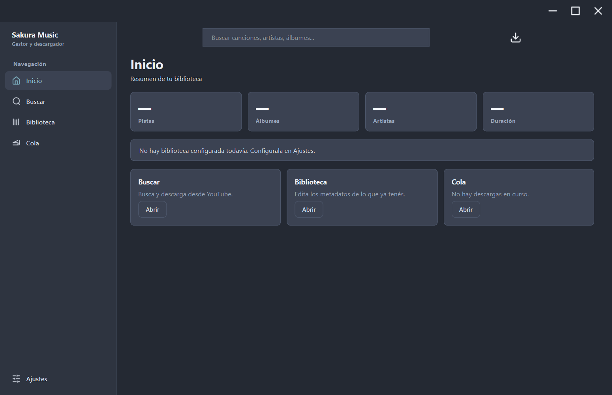
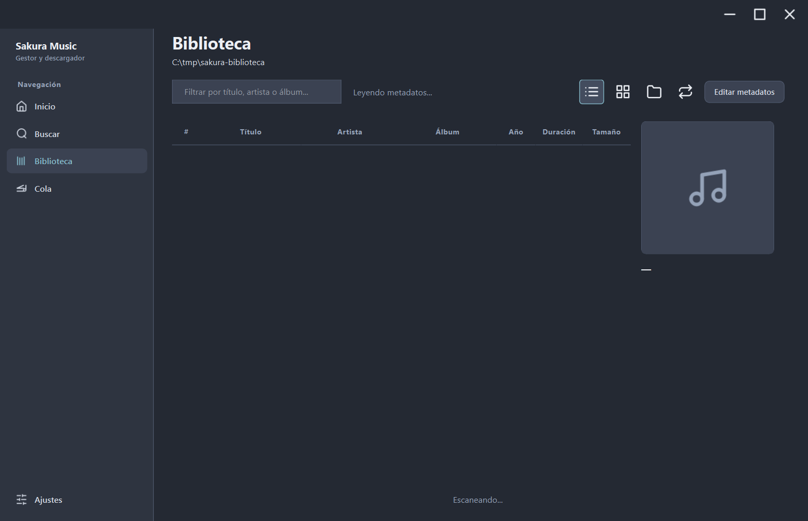

# Documentación de Sakura Music

Esta carpeta contiene la documentación técnica y de referencia del proyecto Sakura Music.

> [!NOTE]
> **Sakura Music 2.0:** el proyecto fue reescrito de Python/PySide6 a **Tauri 2.0 (Rust) + React 19 + TypeScript + Tailwind CSS**.
> El código fuente de la versión 1.0 en Python se conserva íntegro en `legacy_python/` como referencia histórica. Ver [ADR 0009](adr/0009-migracion-tauri-2-rust.md) para el contexto de la migración y [ADR 0010](adr/0010-cierre-seguridad-atomicidad.md) para lo que se corrigió después.

## Por dónde empezar

| Si querés… | Leé |
|---|---|
| Visión general, instalación y arranque rápido | [README principal](../README.md) |
| Arquitectura v2 (Tauri + Rust + React) | [arquitectura.md](arquitectura.md) |
| La promesa verificable de la app | [requisitos.md](requisitos.md) |
| Flujos paso a paso | [casos-de-uso.md](casos-de-uso.md) |
| Setup, tests y recetas | [desarrollo.md](desarrollo.md) |
| Versionar, firmar y publicar | [release.md](release.md) |
| Ver el pipeline de CI | [pipeline.md](pipeline.md) |
| Comandos y eventos disponibles | [ipc-contract.md](ipc-contract.md) |
| Dónde y cómo se guardan los datos | [data-formats.md](data-formats.md) |
| Buscar, descargar y entender la cola | [manual/buscar-y-descargar.md](manual/buscar-y-descargar.md) |
| Escaneo, ordenar y filtrar biblioteca | [manual/biblioteca.md](manual/biblioteca.md) |
| Editar tags, portadas y catálogo | [manual/metadatos-y-letras.md](manual/metadatos-y-letras.md) |
| Cambiar efectos y apariencia | [manual/apariencia.md](manual/apariencia.md) |
| Resolver un error concreto | [manual/problemas.md](manual/problemas.md) |
| Índice de decisiones técnicas | [adr/README.md](adr/README.md) |

## Mapa de la documentación

```text
docs/
  README.md                  este índice
  casos-de-uso.md            actores, CU-01…CU-12 y flujos detallados
  requisitos.md              RF/RNF con criterio de aceptación y tests
  arquitectura.md            capas, hilos, persistencia, seguridad y secuencias
  desarrollo.md              setup, tests, tipos y recetas para extender
  release.md                 versionado, build, firma y publicación
  pipeline.md                diagrama y etapas del CI
  ipc-contract.md            22 comandos Tauri y 4 eventos (contrato frontend/Rust)
  data-formats.md            SQLite, download_queue.json y preferencias
  manual/
    README.md                índice del manual
    instalacion.md           requisitos, ffmpeg, yt-dlp, datos y arranque
    buscar-y-descargar.md    búsqueda, playlists, cola, errores
    biblioteca.md            escaneo, caché, vistas y reproducción
    metadatos-y-letras.md    editor, lote, catálogos, portadas
    apariencia.md            efectos, apariencia y vistas
    problemas.md             síntomas, causas y qué hacer
  adr/
    README.md                índice de decisiones
    0001-pyside6.md          histórico v1 (reemplazado por 0009)
    0002-yt-dlp-subproceso.md
    0003-tags-fuente-de-verdad.md
    0004-indice-por-mtime-y-tamano.md
    0005-modelo-no-widgets.md
    0006-temas-por-tokens.md
    0007-deshacer-con-manifiestos.md
    0008-hilos-y-cierre-limpio.md
    0009-migracion-tauri-2-rust.md
    0010-cierre-seguridad-atomicidad.md
    0011-cola-persistente.md
  temas/                     propuestas de diseño HTML (no implementadas)
  img/                       capturas históricas (v1, pendientes de reemplazo)
    preview_home.png           inicio (v1)
    preview_search.png         buscar (v1)
    preview_playlist.png       playlist en buscar (v1)
    preview_queue.png          cola (v1)
    preview_library.png        biblioteca (v1)
    preview_settings.png       ajustes (v1)
```

## Capturas

> ⚠️ Las imágenes de abajo son renders de la **UI de la v1 (PySide6)**, no de
> la app Tauri/React actual. Se conservan como referencia visual hasta que se
> generen capturas de la v2.







## Convenciones

- **Idioma:** español rioplatense, con voseo, igual que la interfaz y el README.
- **Código:** las rutas se escriben relativas a la raíz del repo
  (`src-tauri/src/scanner.rs`), no como enlaces absolutos.
- **Requisitos:** cada uno tiene un identificador estable (`RF-03`, `RNF-02`) y
  un criterio de aceptación verificable. Cuando existe un test que lo cubre, se
  nombra el archivo.
- **Casos de uso:** `CU-01`…`CU-12`, cada uno con flujo principal, alternativos
  y "dónde está" en el código.
- **Diagramas:** Mermaid embebido en Markdown. GitHub, GitLab y la vista previa
  de VS Code lo renderizan sin instalar nada. No hay build ni sitio aparte.
- **Capturas:** `docs/img/` son históricas de la v1 (generadas con los scripts
  de `legacy_python/scripts/preview_*.py`). Las capturas de la v2 están
  pendientes.

## Estado y mantenimiento

| Documento | Última revisión | Fuente principal |
|---|---|---|
| `casos-de-uso.md` | 2026-11-17 | `src/App.tsx`, `src-tauri/src/` |
| `requisitos.md` | 2026-11-17 | código + `cargo test` (21 tests) + `tsc` |
| `arquitectura.md` | 2026-11-17 | `src-tauri/src/`, `src/App.tsx`, `tauri.conf.json` |
| `ipc-contract.md` | 2026-11-17 | `lib.rs`, `catalog.rs`, `downloader.rs`, `library_watcher.rs` |
| `data-formats.md` | 2026-11-17 | `library_db.rs`, `queue.rs`, `paths.rs`, `localStorage` |
| `manual/` | 2026-11-17 | interfaz real + `tauri.conf.json` |
| `adr/` | 2026-11-17 | 0009 (migración) + 0010 (cierre) + 0011 (cola persistente) |
| `desarrollo.md` | 2026-11-17 | `package.json`, `src-tauri/Cargo.toml` |

La documentación se actualiza **cuando cambia el comportamiento**, no cuando
cambia una línea. Si un cambio invalida un requisito, actualizá el requisito y su
criterio de aceptación en el mismo commit. Si agrega una decisión estructural,
sumá un ADR nuevo en vez de reescribir los viejos.

## Qué no vive acá

- El **porqué** detallado de cada decisión de diseño: está en el
  [README](../README.md) y en los [ADRs](adr/README.md).
- La **referencia de API** generada: los módulos ya tienen docstrings y el
  proyecto no publica un sitio.
- **Documentación componente por componente:** se documentan las páginas y los
  flujos, no cada `div` de `App.tsx`. Ese nivel se lee mejor en el código.
