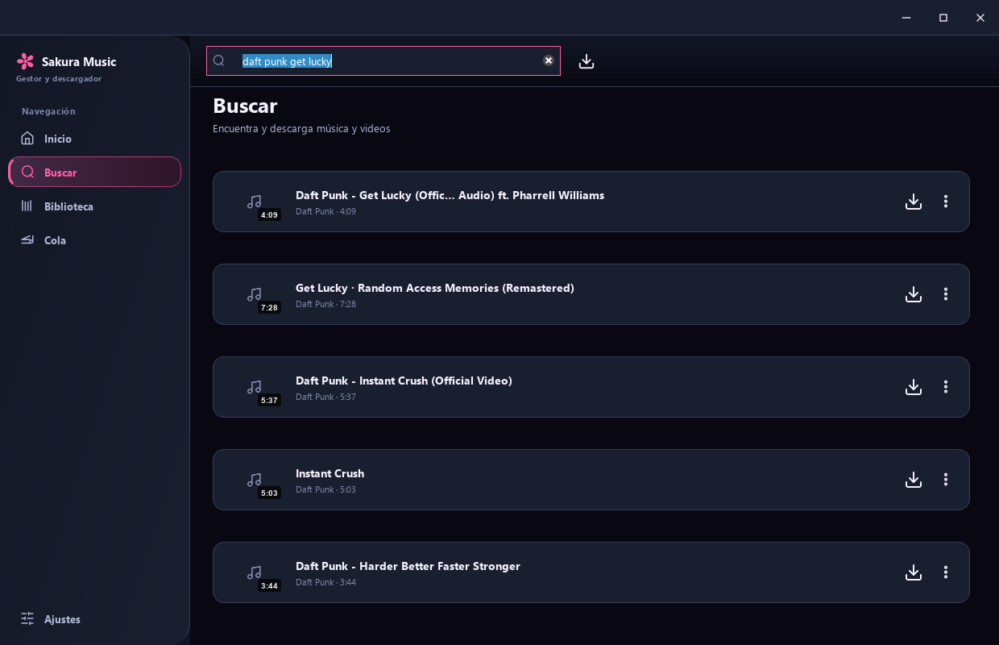
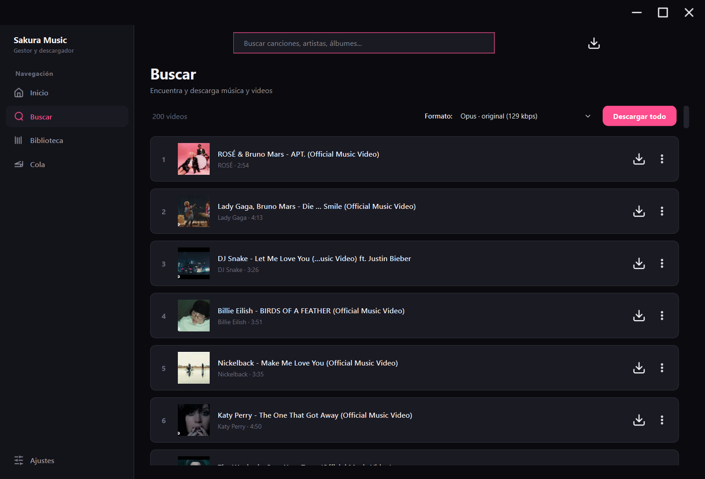
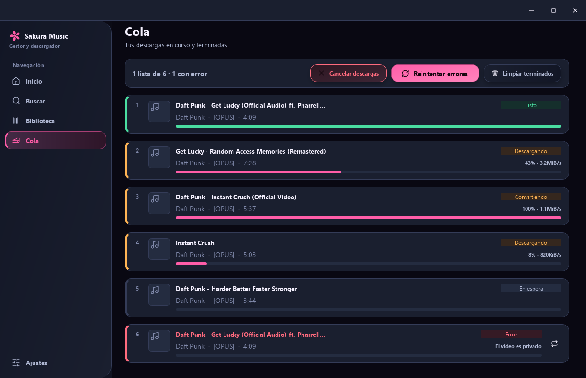
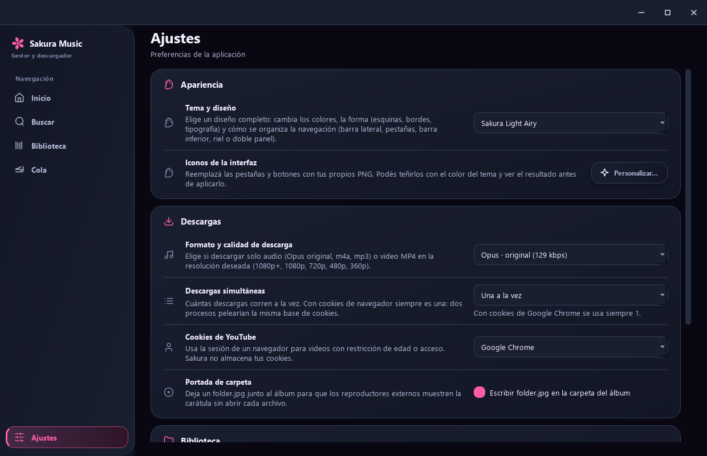

# Documentación de Sakura Music

Esta carpeta contiene la documentación técnica y de referencia del proyecto Sakura Music.

> [!NOTE]
> **Sakura Music 2.0:** El proyecto fue completamente modernizado de Python/PySide6 a una arquitectura nativa con **Tauri 2.0 (Rust backend) + React 18 + TypeScript + Tailwind CSS**.
> El código fuente de la versión 1.0 en Python se conserva íntegro en `legacy_python/` como referencia histórica. Consulta el [ADR 0009](adr/0009-migracion-tauri-2-rust.md) para más detalles.

## Por dónde empezar

| Si querés… | Leé |
|---|---|
| Visión general, instalación y arranque rápido | [README principal](../README.md) |
| Arquitectura v2.0 (Tauri + Rust + React) | [ADR 0009: Migración a Tauri 2 y Rust](adr/0009-migracion-tauri-2-rust.md) |
| Buscar, descargar y entender la cola | [manual/buscar-y-descargar.md](manual/buscar-y-descargar.md) |
| Escaneo, ordenar y filtrar biblioteca | [manual/biblioteca.md](manual/biblioteca.md) |
| Editar tags, portadas y catálogo | [manual/metadatos-y-letras.md](manual/metadatos-y-letras.md) |
| Cambiar tema, iconos y apariencia | [manual/apariencia.md](manual/apariencia.md) |
| Resolver un error concreto | [manual/problemas.md](manual/problemas.md) |
| Índice de decisiones técnicas | [adr/README.md](adr/README.md) |

## Mapa de la documentación

```text
docs/
  README.md                  este índice
  casos-de-uso.md            actores, CU-01…CU-16 y flujos detallados
  requisitos.md              RF/RNF con criterio de aceptación y test que los cubre
  arquitectura.md            capas, modelo de hilos, persistencia y 3 secuencias
  desarrollo.md              setup, lint, tests y recetas para extender
  manual/
    README.md                índice del manual
    instalacion.md           requisitos, ffmpeg, yt-dlp, datos y arranque
    buscar-y-descargar.md    búsqueda, playlists, álbumes, cola y reintentos
    biblioteca.md            escaneo, índice, watcher, vistas y filtros
    metadatos-y-letras.md    editor, catálogos, lote, deshacer y LRCLIB
    apariencia.md            temas, shells, densidad, iconos y atajos
    problemas.md             síntomas, causas y qué hacer
  adr/
    README.md                índice de decisiones
    0001-pyside6.md          por qué PySide6 y no Electron
    0002-yt-dlp-subproceso.md
    0003-tags-fuente-de-verdad.md
    0004-indice-por-mtime-y-tamano.md
    0005-modelo-no-widgets.md
    0006-temas-por-tokens.md
    0007-deshacer-con-manifiestos.md
    0008-hilos-y-cierre-limpio.md
  img/                       capturas de las páginas principales
    preview_home.png           inicio
    preview_search.png         buscar
    preview_playlist.png       playlist en buscar
    preview_queue.png          cola
    preview_library.png        biblioteca
    preview_settings.png       ajustes
```

## Capturas











## Convenciones

- **Idioma:** español rioplatense, con voseo, igual que la interfaz y el README.
- **Código:** las rutas se escriben relativas a la raíz del repo
  (`sakura/ui/services/downloader.py`), no como enlaces absolutos.
- **Requisitos:** cada uno tiene un identificador estable (`RF-03`, `RNF-02`) y
  un criterio de aceptación verificable. Cuando existe un test que lo cubre, se
  nombra el archivo.
- **Casos de uso:** `CU-01`…`CU-16`. Los seis principales tienen flujo paso a
  paso; el resto está en la tabla resumen.
- **Diagramas:** Mermaid embebido en Markdown. GitHub, GitLab y la vista previa
  de VS Code lo renderizan sin instalar nada. No hay build ni sitio aparte.
- **Capturas:** las imágenes de `docs/img/` son renders headless de la app real,
  generados con los scripts de `scripts/preview_*.py`.

## Estado y mantenimiento

| Documento | Última revisión | Fuente principal |
|---|---|---|
| `casos-de-uso.md` | 2026-11-07 | `sakura/ui/pages/`, `sakura/ui/services/` |
| `requisitos.md` | 2026-11-07 | código + `tests/` (1178 tests) |
| `arquitectura.md` | 2026-11-07 | `sakura/core/`, `sakura/ui/`, `sakura/config.py` |
| `manual/` | 2026-11-07 | interfaz, `config.py`, `README.md` |
| `adr/` | 2026-11-07 | decisiones del README, formalizadas |
| `desarrollo.md` | 2026-11-07 | `pyproject.toml`, `scripts/`, `tests/` |

La documentación se actualiza **cuando cambia el comportamiento**, no cuando
cambia una línea. Si un cambio invalida un requisito, actualizá el requisito y su
criterio de aceptación en el mismo commit. Si agrega una decisión estructural,
sumá un ADR nuevo en vez de reescribir los viejos.

## Qué no vive acá

- El **porqué** detallado de cada decisión de diseño: está en el
  [README](../README.md) y en los [ADRs](adr/README.md).
- La **referencia de API** generada: los módulos ya tienen docstrings y el
  proyecto no publica un sitio. Si algún día se publica, se puede sumar
  `mkdocstrings` sin mover estos archivos.
- **Documentación widget por widget:** se documentan las páginas y los flujos,
  no cada `QLabel`. Ese nivel se lee mejor en el código.
