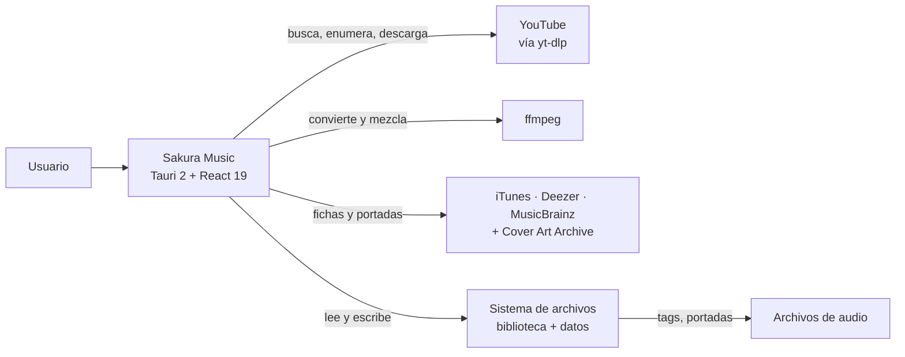
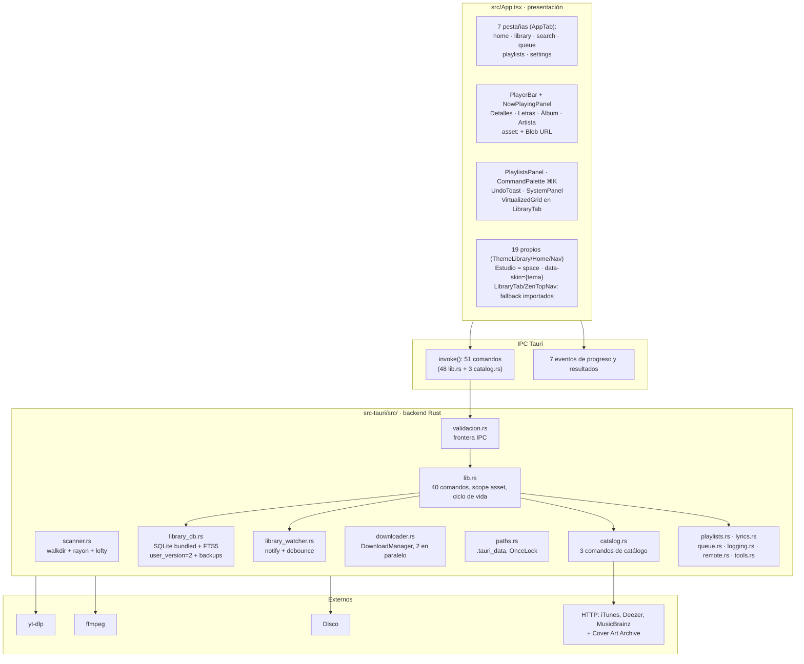
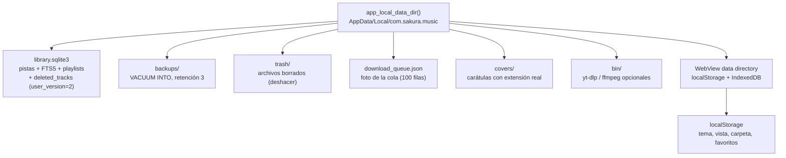

# Arquitectura

Sakura Music 2.0 es una app de escritorio monousuario: una ventana Tauri que
renderiza React, un backend Rust que escanea el disco, edita tags y orquesta
`yt-dlp` / `ffmpeg`, y un sistema de archivos local. No hay servidor, cuentas ni
base de datos remota. La versión 1.0 en PySide6 vive en `legacy_python/`.

## Vista de contexto



Todo lo externo es fuente o destino: YouTube y los catálogos se consultan,
`ffmpeg` transforma y el disco guarda el resultado. El estado propio vive en la
caché SQLite (con playlists, papelera e índice FTS5), la carpeta de carátulas,
los respaldos y las preferencias del navegador. La app es local-first: no hay
servidor, cuentas ni login.

## Capas



| Capa | Responsabilidad | No debe |
|---|---|---|
| `src/App.tsx` | Seis pestañas (`AppTab`), reproductor, editor, cola, temas. Lee `localStorage` para preferencias. | Leer tags ni lanzar `yt-dlp` directamente |
| Componentes `src/components/` | `NowPlayingPanel` (Detalles/Letras/Álbum/Artista), `PlaylistsPanel`, `CommandPalette` (⌘K), `UndoToast`, `SystemPanel`, `VirtualizedGrid`; `ThemeLibrary`/`ThemeHome`/`ThemeNav` para los 19 temas propios. | Hablar directo con Rust: todo pasa por `invoke`/eventos |
| `lib.rs` | Registrar los 40 comandos propios, inicializar carpeta de datos, autorizar carpetas en el scope `asset:`, cancelar descargas al salir. | Contener lógica de parsing o pesos |
| `catalog.rs` | Consultar iTunes, Deezer y MusicBrainz (con portadas de Cover Art Archive) vía `reqwest`, con User-Agent propio, y exponer 3 comandos Tauri. | Hacer `fetch` desde el frontend (CORS/User-Agent) ni pintar UI |
| `validacion.rs` | Validar en la frontera IPC (longitudes, caracteres de control, rutas y lotes) y exigir scope canónico para escrituras. | Confiar en lo que manda el frontend |
| `scanner.rs` | Enumerar y leer pistas en paralelo, lectura/escritura de tags con `lofty`, carátulas con extensión real. | Conocer React ni `localStorage` |
| `library_db.rs` | Persistir la biblioteca en SQLite (`rusqlite` bundled + FTS5), migraciones `user_version`, respaldos `VACUUM INTO`, doctor y logs. | Leer tags o conocer React |
| `library_watcher.rs` | Vigilar recursivamente la carpeta seleccionada y agrupar cambios del sistema de archivos. | Leer tags o modificar la biblioteca directamente |
| `playlists.rs` / `lyrics.rs` | Tablas `playlists`/`playlist_tracks` con `ON DELETE CASCADE`; parser `.lrc` con múltiples timestamps. | Pintar UI |
| `queue.rs` / `downloader.rs` | Cola persistente; búsqueda, resolución de playlists, `DownloadManager` con `Mutex` + `Condvar`, cancelación por PID. | Pintar UI |
| `paths.rs` / `logging.rs` / `remote.rs` / `tools.rs` | Única verdad sobre la carpeta de datos (`OnceLock`), logs redactados, control HTTP local, detección e instalación de binarios con SHA256 fijo. | Duplicar resolución de rutas ni exponer secretos |

> Nota: las vistas genéricas viven en `LibraryTab.tsx` (9 vistas) y usan
> `VirtualizedGrid` con `content-visibility` condicional en bibliotecas de más
> de 60 pistas, pero hoy son sólo fallback para temas importados: ningún tema
> oficial las usa. Los 19 temas propios, incluidos Estudio (`space`) y los cinco nuevos, tienen
> `ThemeLibrary`/`ThemeHome`/`ThemeNav` y sus propios diálogos, iconos y splash.
> `App.tsx` conserva el estado raíz y el player; las piezas grandes nuevas se
> separan en `src/components/`.

## Modelo de hilos

- **Escaneo:** `rayon` con `par_iter` solo sobre pistas nuevas o modificadas. El vigilante agrupa eventos por 700 ms y dispara una resincronización incremental.
- **Descargas:** cada `start_download` crea un hilo Rust (`std::thread::spawn`) que espera turno en `DownloadManager::acquire` y corre `yt-dlp` como proceso hijo. El `DownloadManager` es `Arc<Mutex<...>>` compartido vía `State`.
- **Progreso y resultados:** los procesos de búsqueda/playlist emiten cada pista al leerla; las descargas emiten `download-progress`. El frontend correlaciona resultados con un id de solicitud.
- **Cola:** rechaza duplicados activos por pista, carpeta y formato. Al relanzar una descarga, `yt-dlp --continue` permite reutilizar el archivo parcial.
- **Cancelación:** `cancel_download(job_id)` marca el job como cancelado y mata el PID (`taskkill /T /F` en Windows). Si el job aún no tomó turno, el `acquire` devuelve `false` y se emite `cancelado`.
- **Cierre:** en `RunEvent::Exit` se llama `manager.cancel_all()`, que marca todos los jobs y mata todos los PIDs registrados. No quedan `yt-dlp` huérfanos.

### Reglas

1. Nada pesado corre en el hilo de la WebView: escaneo, tags y descargas viven en Rust.
2. Como máximo 2 descargas corren a la vez (`DownloadManager::new(2)`). La tercera espera turno.
3. El frontend es el único dueño de la cola visual; el backend es el dueño de los procesos.
4. `stderr` de `yt-dlp` se captura en su propio hilo para no bloquear `stdout`.
5. Si el usuario cancela mientras `yt-dlp` está en `finished`/convirtiendo, el estado final sigue respeta la cancelación (`is_cancelled` se chequea tras `wait`).

## Persistencia

La biblioteca usa SQLite (`rusqlite` con SQLite bundled, FTS5 y `user_version=2`)
para conservar pistas, playlists y papelera, y detectar cambios entre escaneos.
La cola de descargas sigue guardándose como JSON.



| Dato | Archivo / clave | Formato | Retención |
|---|---|---|---|
| Biblioteca | `library.sqlite3` | SQLite bundled; FTS5 + triggers (v1), índices artist/album/year/genre (v2); importación inicial desde JSON legado | Índice reconstruible desde los audios |
| Playlists | tablas `playlists` / `playlist_tracks` | SQLite, `foreign_keys=ON` y `ON DELETE CASCADE` | Permanente hasta borrar la lista |
| Papelera | `deleted_tracks` + `trash/` | Fila con token + archivo movido; `restore_deleted_track`, `empty_trash` | Hasta deshacer o vaciar (toast de 9 s) |
| Respaldos | `backups/` | `VACUUM INTO` consistente con WAL | 3 más recientes; uno automático antes de migrar |
| Cola | `download_queue.json` | JSON, escritura atómica | 100 filas más recientes; lo activo vuelve como `interrumpida` |
| Carátulas | `covers/` | JPG/PNG/WebP/GIF/BMP/TIFF reales | Cache, deduplicada por hash |
| Portadas temporales | `covers/temp_*` | Imagen cualquiera | Se borran al arrancar y antes de guardar una nueva |
| Preferencias | `localStorage` (`sakura_*`) | JSON/strings | Permanente |
| Audio | biblioteca del usuario | MP3/FLAC/M4A/Opus/OGG/WAV/AAC | Los tags son la fuente de verdad |

**Los tags del archivo son la fuente de verdad.** La caché es solo para arrancar
rápido; si se borra o se corrompe, `get_cached_library` devuelve `[]` y un
escaneo completo la reconstruye.

### Resolución de la carpeta de datos

`paths::init()` se llama una sola vez en `setup()` con
`app.path().app_local_data_dir()`. `paths::data_dir()` la lee vía `OnceLock`
y cae a `./.tauri_data` en tests o llamadas tempranas. Nunca se usa el
`current_dir()` como carpeta de datos en producción (en Windows puede ser
`System32`).

- **Persistencia de la cola:** cada cambio se guarda al instante vía
  `save_download_queue`; al arrancar, `get_download_queue` restaura y el
  frontend relanza lo `interrumpido` con el mismo id/destino/formato.

### Escritura atómica

`scanner::write_atomic()` escribe a un temporal en la misma carpeta
(`.<nombre>.<pid>.<timestamp>.tmp`), hace `sync_all()` y luego `rename`.
`write_atomic_with_retries(..., 4)` reintenta con pausa lineal. Se usa para
tags, caché y portadas. En Windows el archivo temporal se cierra antes del
rename (el handle abierto bloquea el reemplazo).

### Base de datos: PRAGMAs y migraciones

`library_db.rs` abre con `WAL`, `synchronous=NORMAL`, `temp_store=MEMORY` y
`foreign_keys=ON`. El esquema se versiona con `PRAGMA user_version`: **1** agrega
FTS5 y sus disparadores de mantenimiento; **2** agrega índices por
artista/álbum/año/género. Antes de subir la versión se crea un respaldo con
`VACUUM INTO` y se conservan los 3 más recientes. `doctor_detallado` (comando
`doctor_database`) corre `integrity_check`, reconstruye el índice FTS5 y
devuelve métricas; `backup_database`, `vacuum_database` y `get_system_logs`
(redactando secretos) alimentan Ajustes → Sistema.

## Seguridad

- **CSP estricta** en `tauri.conf.json` (no es `null`): `default-src 'self'`,
  `script-src 'self'`, `style-src` con Google Fonts, `img-src`/`media-src`
  limitados a `asset:`, `data:`, `blob:` y `https:`, `connect-src` solo a
  `ipc:`, `asset:`, dev (`ws://localhost:1420` y `http://localhost:1420`),
  iTunes, Deezer, `musicbrainz.org` y `coverartarchive.org`. `frame-ancestors
  'none'` y `object-src 'none'`.
- **Asset scope acotado:** `["$AUDIO/**", "$APPLOCALDATA/**", "$TEMP/**"]`.
  Como el usuario puede elegir cualquier unidad como biblioteca,
  `scan_library` y `get_cached_library` autorizan en runtime cada carpeta
  (`asset_protocol_scope().allow_directory(parent, true)`), y el arranque
  autoriza la caché de portadas en `.tauri_data/covers`.
- **Sin rutas hardcodeadas:** la búsqueda de binarios nunca apunta a un usuario
  concreto. yt-dlp: carpeta de datos `bin/`, legado `%APPDATA%/sakura-music/bin`,
  `PATH`. ffmpeg: `bin/`, legado `%LOCALAPPDATA%/SakuraMusic/bin`, enlaces de
  winget, `PATH`.
- **Validación en la frontera IPC:** todo argumento que entra por `invoke()`
  pasa por `validacion.rs` (longitud de textos, rutas, lotes, caracteres de
  control y NUL). Las escrituras de metadatos exigen además que la ruta
  canónica de la pista esté dentro de la biblioteca activa y que la portada
  venga de `covers/`; los borrados y movimientos se validan con el mismo
  criterio.
- **Herramientas con SHA256 fijo:** `install_downloader_tools` descarga yt-dlp y
  ffmpeg a `bin/` y verifica el hash contra un valor fijo; nunca sobrescribe un
  binario que ya está en el `PATH`. Los logs del sistema se redactan para no
  filtrar secretos.
- **Sin login:** la app es local-first. Agregar un login local sería teatro
  (no protege nada sin servidor); recién tiene sentido con sincronización y
  hashes Argon2id.
- **Cancelación real:** los PIDs se registran al hacer `spawn` y se matan con
  el árbol completo (`taskkill /T`), porque `yt-dlp` tiene hijos `ffmpeg`.

## Secuencia: escaneo de biblioteca

```mermaid
sequenceDiagram
    autonumber
    actor U as Usuario
    participant ALT as App.tsx
    participant SC as scan_library
    participant RD as rayon + lofty
    participant FS as Disco

    U->>ALT: elige carpeta
    ALT->>SC: invoke(scan_library, carpeta)
    SC->>SC: allow_directory(carpeta, recursive)
    SC->>DB: cargar pistas y fingerprints
    SC->>RD: enumerar archivos y comparar tamaño + modificación
    loop pistas nuevas o modificadas
        RD->>FS: leer tags + carátula
        RD-->>RD: ScannedTrack
    end
    SC->>DB: guardar cambios y quitar pistas ausentes
    SC-->>ALT: tracks
    ALT-->>U: lista + filtro por carpeta
```

## Secuencia: descarga con cancelación

```mermaid
sequenceDiagram
    autonumber
    actor U as Usuario
    participant ALT as App.tsx
    participant DM as DownloadManager
    participant YT as yt-dlp

    U->>ALT: Buscar → Descargar
    ALT->>ALT: crea DownloadItem en cola
    ALT->>DM: invoke(start_download, job_id)
    DM->>DM: spawn hilo, acquire (máx 2)
    DM->>YT: spawn yt-dlp --no-playlist --print after_move
    loop progreso
        YT-->>DM: sakuradl|pct|speed|eta|status
        DM-->>ALT: evento download-progress
    end
    opt usuario cancela
        U->>ALT: X en la fila
        ALT->>DM: invoke(cancel_download, job_id)
        DM->>DM: marca cancelado, taskkill PID
    end
    YT-->>DM: exit
    DM-->>ALT: completado (+ file_path) o cancelado o error
    ALT-->>U: badge, rutas, reintentar si hace falta
```

## Tema visual

La app usa **19 temas, todos propios**: ningún tema oficial es genérico.

- **Estudio** (`space`, por defecto): "Consola de mezcla y medidores VU". Home
  con `EST·01`, medidor VU y rack de canales con faders; biblioteca en canales
  con fader y VU; navegación negra con glifo ◎ y acento ámbar `#f0a23c`. Paleta
  grafito `#15181a`, panel `#1d2226`, verde LED `#7ee081`, texto `#f2ede6` y
  tipografía monospace; estilo propio en Buscar, Cola, Ajustes, panel "Ahora
  suena", playlists, paleta ⌘K, estadísticas, modales de metadatos, splash y
  transición `t-estudio`. Fija `data-theme="space"` y aplica además
  `data-skin="space"`.
- **Los otros dieciocho:** `sumie`, `byobu`, `shoji`, `origami`, `swiss`,
  `sumiink`, `moonlit`, `ledger`, `shonen`, `ghost`, `samurai`, `kawaii`,
  `manga`, `sakura`, `loto`, `ukiyo`, `vinilo` y `karesansui`. Cada uno
  fija `data-theme="space"` y usa `data-skin={tema}`, con `ThemeLibrary`,
  `ThemeHome` y `ThemeNav` propios: cabecera, Buscar, Cola, ajustes, diálogos,
  transiciones, iconos y splash propios. `manga` ("Viñetas, tinta y screentone")
  usa papel `#fbfaf7`, tinta `#101010` y rojo `#d62828` con tramado screentone:
  portada de revista en Home y páginas de viñetas en biblioteca, con cabecera
  negra y glifo 漫; es además arquetipo del generador de temas. Los cinco
  temas nuevos añadidos el 2026-11-25 (`sakura`, `loto`, `ukiyo`, `vinilo` y
  `karesansui`) tienen biblioteca de estructura propia: jardín hanami, rollos
  de seda, estampas apaisadas, estantería de discos y arena rastrillada.

`LibraryTab`/`ZenTopNav` se conservan en el código únicamente como fallback para
temas importados; ningún tema oficial cae en la vista genérica de 9 vistas.

Los tokens semánticos `--m3-*`, `--space-*`, `--accent-*` y `--theme-*` viven en
`App.css`. Tailwind mapea `accent-*` a esas variables, así que
`from-accent-500` o `text-accent-300` siguen al tema sin duplicar clases. El
glifo del splash hace un handoff continuo al logo de la navegación mediante
`view-transition-name: sakura-glifo`; Estudio suma `t-estudio` y Manga la
transición de página `t-manga`. La preferencia se persiste en
`localStorage` (`sakura_theme`). Ver [ADR 0012](adr/0012-temas-multiples.md) y
[diseno.md](diseno.md).

## Subsistemas nuevos

### Playlists

Las listas viven en las tablas `playlists` y `playlist_tracks`, con
`foreign_keys=ON` y `ON DELETE CASCADE`. Los comandos `list_playlists`,
`create_playlist`, `rename_playlist`, `delete_playlist`, `get_playlist`,
`playlist_add_tracks`, `playlist_remove_track` y `playlist_reorder` se exponen
desde `lib.rs` y se consumen en `PlaylistsPanel` (pestaña Listas, también
accesible desde ⌘K). Cada tema propio estiliza el panel.

### Papelera y deshacer

`delete_library_track` no borra el archivo: lo mueve a `<datos>/trash` y
guarda la fila en `deleted_tracks` con un token. `restore_deleted_track` lo
devuelve, `empty_trash` borra definitivamente y `trash_count` informa el
contador que muestra `SystemPanel`. El `UndoToast` ofrece **Deshacer** durante
9 segundos.

### Letras

`lyrics.rs` parsea archivos `.lrc` (varios timestamps por línea y metadatos
`[ar:...]`) y `read_lyrics` devuelve líneas con su tiempo en segundos. El panel
`NowPlayingPanel`, pestaña **Letras**, resalta la línea activa y hace autoscroll
siguiendo `currentTime`.

### Validación

`validacion.rs` es la frontera IPC: valida textos, rutas, cantidades y lotes
antes de tocar el disco. Las operaciones de metadatos y borrado exigen la ruta
canónica dentro de la biblioteca activa y portadas dentro de `covers/`.


## Manejo de errores

| Situación | Qué hace |
|---|---|
| `yt-dlp` ausente | `check_downloader_tools` informa el faltante; `search_online` / `start_download` devuelven error legible |
| `ffmpeg` ausente | La descarga falla en la conversión; no se inventa un binario |
| Corte de red | `--retries 3`, `--socket-timeout 30`; al fallar se emite `error: <última línea de stderr>` y la fila ofrece Reintentar |
| Resultado lento | Búsqueda y playlist muestran las pistas a medida que llegan de `yt-dlp` |
| Descarga duplicada | Se impide encolar la misma pista, carpeta y formato mientras siga activa |
| Lote parcial | `update_batch_metadata` devuelve `{ updated, errors }`; la UI muestra cuántos fallaron y las 3 primeras razones |
| Caché corrupta | `get_cached_library` devuelve `[]`; el próximo escaneo la reconstruye |
| Carpeta inexistente | `scan_library` devuelve `[]` sin escribir caché |
| Archivo con solo-lectura | Se quita el flag antes de escribir y se reintenta 4 veces |
| Portada temporal vieja | `cleanup_temp_covers` borra `temp_*` al arrancar |
| Búsqueda FTS fallida | `search_library_fts` falla y el frontend cae al filtro local |
| BD corrupta antes de migrar | Se restaura el último respaldo `VACUUM INTO`; `doctor_detallado` informa `integrity_check` |
| Borrar con deshacer | El archivo va a `trash/` y queda una fila en `deleted_tracks`; si vence el toast, se vacía desde Ajustes |

## Puntos de extensión

| Querés agregar… | Tocá | Cuidá |
|---|---|---|
| Un comando Tauri | `src-tauri/src/lib.rs` + `App.tsx` (`invoke`) | Registrarlo en `invoke_handler!` y mapear errores como `String` |
| Un formato de descarga | `src-tauri/src/downloader.rs` (rama `fmt_lower` en `run_download`) | Agregar tests de parsing si cambia el progreso |
| Un tema importado nuevo (fallback genérico) | `src/App.css` (tokens bajo `[data-skin='id']`) + `ThemeMode` en `src/types.ts` | Reutiliza `LibraryTab` de 9 vistas; mantiene `data-theme="space"` fijo. Los temas oficiales no usan este camino |
| Un tema propio nuevo | Bloques `.app-shell[data-skin='id']` en `App.css` + `ThemeLibrary`/`ThemeHome`/`ThemeNav` nuevos | Debe proveer cabecera, Buscar, Cola, ajustes, diálogos, transiciones, iconos y splash propios |
| Una vista nueva | `src/components/LibraryTab.tsx` (ramas `viewMode`) y `src/components/LibraryShowcase.tsx` | El tipo `ViewMode`, el switcher en `LibraryToolbar.tsx`, las 9 vistas existentes y `VirtualizedGrid` si pasa de 60 pistas |
| Una fuente de catálogo | `src-tauri/src/catalog.rs` (comandos `search_catalog_songs`, `search_catalog_albums` y `open_catalog_album`) | Respetar el CSP: están permitidos `itunes.apple.com`, `api.deezer.com`, `musicbrainz.org` y `coverartarchive.org` (`ws://localhost:1420` solo en dev) |

Los detalles de cada receta están en [desarrollo.md](desarrollo.md).
