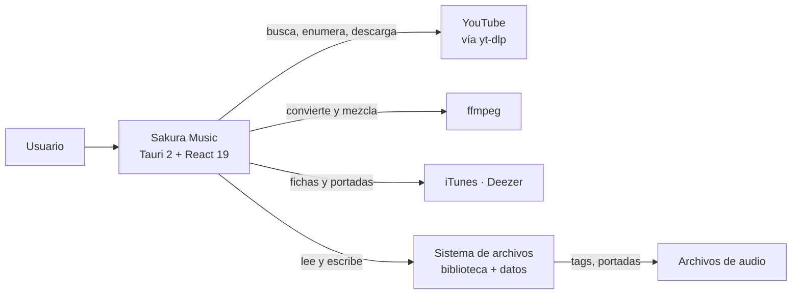
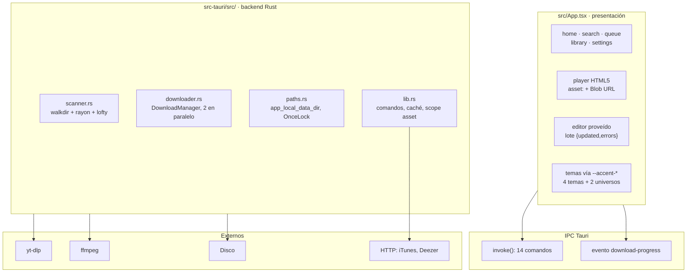
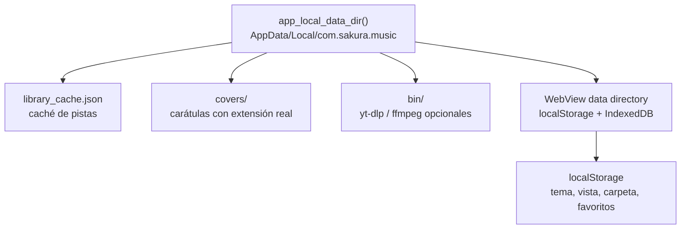

# Arquitectura

Sakura Music 2.0 es una app de escritorio monousuario: una ventana Tauri que
renderiza React, un backend Rust que escanea el disco, edita tags y orquesta
`yt-dlp` / `ffmpeg`, y un sistema de archivos local. No hay servidor, cuentas ni
base de datos remota. La versión 1.0 en PySide6 vive en `legacy_python/`.

## Vista de contexto



Todo lo externo es fuente o destino: YouTube y los catálogos se consultan,
`ffmpeg` transforma y el disco guarda el resultado. El único estado propio es la
caché de biblioteca, la carpeta de carátulas y las preferencias del navegador.

## Capas



| Capa | Responsabilidad | No debe |
|---|---|---|
| `src/App.tsx` | Pestañas, reproductor, editor, cola, temas. Lee `localStorage` para preferencias. | Leer tags ni lanzar `yt-dlp` directamente |
| `lib.rs` | Registrar comandos, inicializar carpeta de datos, autorizar carpetas en el scope `asset:`, cancelar descargas al salir. | Contener lógica de parsing o pesos |
| `scanner.rs` | Escaneo paralelo, lectura/escritura de tags con `lofty`, carátulas con extensión real, escritura atómica. | Conocer React ni `localStorage` |
| `downloader.rs` | Búsqueda, resolución de playlists, cola con `Mutex` + `Condvar`, cancelación por PID, parsing de progreso. | Pintar UI |
| `paths.rs` | Única verdad sobre la carpeta de datos (`OnceLock` + fallback a `.tauri_data`). | Duplicar resolución de rutas |

> Deuda conocida: `App.tsx` es un monolito de ~4600 líneas. Funciona, pero un
> componente grande nuevo debería vivir en su propio archivo.

## Modelo de hilos

- **Escaneo:** `rayon` con `par_iter` sobre la lista de archivos. Sin hilo principal bloqueado.
- **Descargas:** cada `start_download` crea un hilo Rust (`std::thread::spawn`) que espera turno en `DownloadManager::acquire` y corre `yt-dlp` como proceso hijo. El `DownloadManager` es `Arc<Mutex<...>>` compartido vía `State`.
- **Progreso:** el hilo lee `stdout` línea por línea y emite `download-progress`. El frontend escucha y actualiza la fila por `id`.
- **Cancelación:** `cancel_download(job_id)` marca el job como cancelado y mata el PID (`taskkill /T /F` en Windows). Si el job aún no tomó turno, el `acquire` devuelve `false` y se emite `cancelado`.
- **Cierre:** en `RunEvent::Exit` se llama `manager.cancel_all()`, que marca todos los jobs y mata todos los PIDs registrados. No quedan `yt-dlp` huérfanos.

### Reglas

1. Nada pesado corre en el hilo de la WebView: escaneo, tags y descargas viven en Rust.
2. Como máximo 2 descargas corren a la vez (`DownloadManager::new(2)`). La tercera espera turno.
3. El frontend es el único dueño de la cola visual; el backend es el dueño de los procesos.
4. `stderr` de `yt-dlp` se captura en su propio hilo para no bloquear `stdout`.
5. Si el usuario cancela mientras `yt-dlp` está en `finished`/convirtiendo, el estado final sigue respeta la cancelación (`is_cancelled` se chequea tras `wait`).

## Persistencia

No hay SQLite en la v2. Cada dato tiene el formato más simple que le sirve:



| Dato | Archivo / clave | Formato | Retención |
|---|---|---|---|
| Biblioteca | `library_cache.json` | JSON, escritura atómica | Descartable, se reconstruye |
| Carátulas | `covers/` | JPG/PNG/WebP/GIF/BMP/TIFF reales | Cache, deduplicada por hash |
| Portadas temporales | `covers/temp_*` | Imagen cualquiera | Se borran al arrancar y antes de guardar una nueva |
| Preferencias | `localStorage` (`sakura_*`) | JSON/strings | Permanente |
| Audio | biblioteca del usuario | MP3/FLAC/M4A/Opus/OGG/WAV/AAC | Los tags son la fuente de verdad |

**Los tags del archivo son la fuente de verdad.** La caché es solo para arrancar
rápido; si se borra o se corrompe, `get_cached_library` devuelve `[]` y un
escaneo completo la reconstruye.

### Resolución de la carpeta de datos

`paths::init()` se llama una sola vez en `setup()` con
`app.path().app_local_data_dir()`. `paths::data_dir()` la lee vía `OnceLock`
y cae a `./.tauri_data` en tests o llamadas tempranas. Nunca se usa el
`current_dir()` como carpeta de datos en producción (en Windows puede ser
`System32`).

### Escritura atómica

`scanner::write_atomic()` escribe a un temporal en la misma carpeta
(`.<nombre>.<pid>.<timestamp>.tmp`), hace `sync_all()` y luego `rename`.
`write_atomic_with_retries(..., 4)` reintenta con pausa lineal. Se usa para
tags, caché y portadas. En Windows el archivo temporal se cierra antes del
rename (el handle abierto bloquea el reemplazo).

## Seguridad

- **CSP estricta** en `tauri.conf.json` (no es `null`): `default-src 'self'`,
  `script-src 'self'`, `style-src` con Google Fonts, `img-src`/`media-src`
  limitados a `asset:`, `data:`, `blob:` y `https:`, `connect-src` solo a
  `ipc:`, `asset:`, dev (`localhost:1420`) e iTunes/Deezer. `frame-ancestors
  'none'` y `object-src 'none'`.
- **Asset scope acotado:** `["$AUDIO/**", "$APPLOCALDATA/**", "$TEMP/**"]`.
  Como el usuario puede elegir cualquier unidad como biblioteca,
  `scan_library` y `get_cached_library` autorizan en runtime cada carpeta
  (`asset_protocol_scope().allow_directory(parent, true)`) y existe el comando
  `allow_music_dir` para el diálogo de carpeta.
- **Sin rutas hardcodeadas:** la búsqueda de binarios nunca apunta a un usuario
  concreto. yt-dlp: carpeta de datos `bin/`, legado `%APPDATA%/sakura-music/bin`,
  `PATH`. ffmpeg: `bin/`, legado `%LOCALAPPDATA%/SakuraMusic/bin`, enlaces de
  winget, `PATH`.
- **Cancelación real:** los PIDs se registran al hacer `spawn` y se matan con
  el árbol completo (`taskkill /T`), porque `yt-dlp` tiene hijos `ffmpeg`.

## Secuencia: escaneo de biblioteca

```mermaid
sequenceDiagram
    autonumber
    actor U as Usuario
    participant ALT as App.tsx
    participant SC as scan_library
    participant RD as rayon + lofty
    participant FS as Disco

    U->>ALT: elige carpeta
    ALT->>SC: invoke(scan_library, carpeta)
    SC->>SC: allow_directory(carpeta, recursive)
    SC->>RD: scan_directory_parallel
    loop cada archivo de audio
        RD->>FS: leer tags + carátula
        RD-->>RD: ScannedTrack
    end
    RD-->>SC: Vec<ScannedTrack>
    SC->>FS: write_atomic(library_cache.json)
    SC-->>ALT: tracks
    ALT-->>U: lista + filtro por carpeta
```

## Secuencia: descarga con cancelación

```mermaid
sequenceDiagram
    autonumber
    actor U as Usuario
    participant ALT as App.tsx
    participant DM as DownloadManager
    participant YT as yt-dlp

    U->>ALT: Buscar → Descargar
    ALT->>ALT: crea DownloadItem en cola
    ALT->>DM: invoke(start_download, job_id)
    DM->>DM: spawn hilo, acquire (máx 2)
    DM->>YT: spawn yt-dlp --no-playlist --print after_move
    loop progreso
        YT-->>DM: sakuradl|pct|speed|eta|status
        DM-->>ALT: evento download-progress
    end
    opt usuario cancela
        U->>ALT: X en la fila
        ALT->>DM: invoke(cancel_download, job_id)
        DM->>DM: marca cancelado, taskkill PID
    end
    YT-->>DM: exit
    DM-->>ALT: completado (+ file_path) o cancelado o error
    ALT-->>U: badge, rutas, reintentar si hace falta
```

## Secuencia: cambio de tema

```mermaid
sequenceDiagram
    autonumber
    actor U as Usuario
    participant ALT as App.tsx
    participant CSS as App.css + tailwind
    ALT->>ALT: setTheme + localStorage sakura_theme
    ALT->>ALT: data-theme en el contenedor raíz
    ALT-->>CSS: --accent-* cambian
    CSS-->>U: toda la UI recolorea al instante
```

Cada tema define 8 valores `--accent-200…950` en `App.css` (`:root` es Sakura;
`[data-theme='cyber'|'amber'|'emerald']` los pisan). Tailwind mapea
`accent-*` a esos valores, así que `from-accent-500` o `text-accent-300` siguen
al tema sin duplicar clases. Los universos Sakura Zen / Wuxia Jianghu fuerzan
sus propios fondos, glows y textos; el tema de color sigue aplicando dentro.

## Manejo de errores

| Situación | Qué hace |
|---|---|
| `yt-dlp` ausente | `check_downloader_tools` informa el faltante; `search_online` / `start_download` devuelven error legible |
| `ffmpeg` ausente | La descarga falla en la conversión; no se inventa un binario |
| Corte de red | `--retries 3`, `--socket-timeout 30`; al fallar se emite `error: <última línea de stderr>` y la fila ofrece Reintentar |
| Lote parcial | `update_batch_metadata` devuelve `{ updated, errors }`; la UI muestra cuántos fallaron y las 3 primeras razones |
| Caché corrupta | `get_cached_library` devuelve `[]`; el próximo escaneo la reconstruye |
| Carpeta inexistente | `scan_library` devuelve `[]` sin escribir caché |
| Archivo con solo-lectura | Se quita el flag antes de escribir y se reintenta 4 veces |
| Portada temporal vieja | `cleanup_temp_covers` borra `temp_*` al arrancar |

## Puntos de extensión

| Querés agregar… | Tocá | Cuidá |
|---|---|---|
| Un comando Tauri | `src-tauri/src/lib.rs` + `App.tsx` (`invoke`) | Registrarlo en `invoke_handler!` y mapear errores como `String` |
| Un formato de descarga | `src-tauri/src/downloader.rs` (rama `fmt_lower` en `run_download`) | Agregar tests de parsing si cambia el progreso |
| Un tema nuevo | `src/App.css` (`[data-theme='...']`) + tipo `ThemeMode` en `App.tsx` | Definir los 8 `--accent-*`; el selector del sidebar es fijo (4 botones) |
| Una vista nueva | `src/App.tsx` (ramas `viewMode`) | El tipo `ViewMode` y las 4 ramas no se antipan |
| Una fuente de catálogo | `src/App.tsx` (`searchCatalog`) | Respetar el CSP: solo `itunes.apple.com` y `api.deezer.com` están permitidos |

Los detalles de cada receta están en [desarrollo.md](desarrollo.md).
