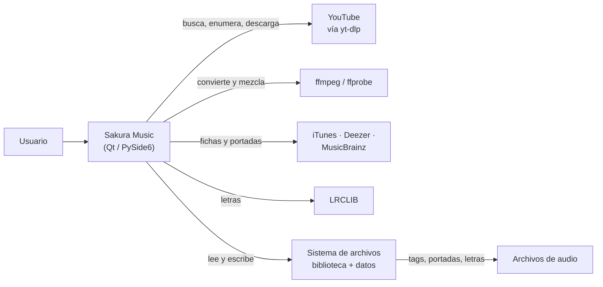
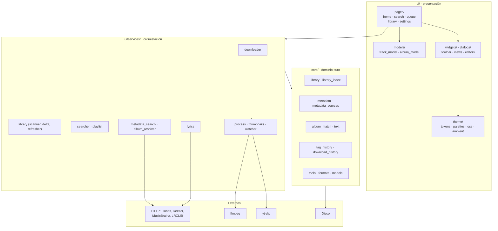
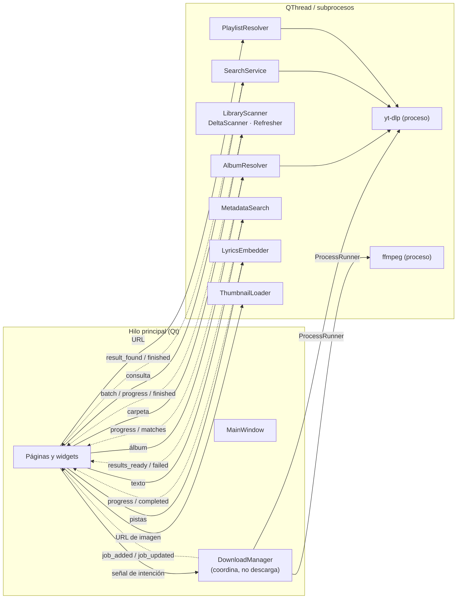
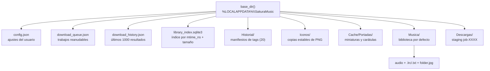
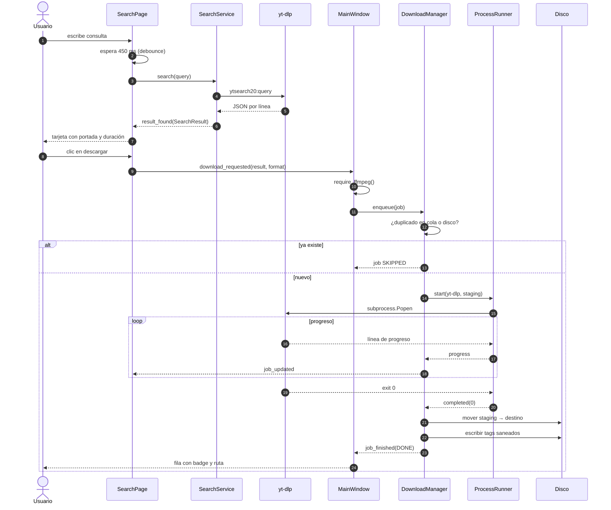
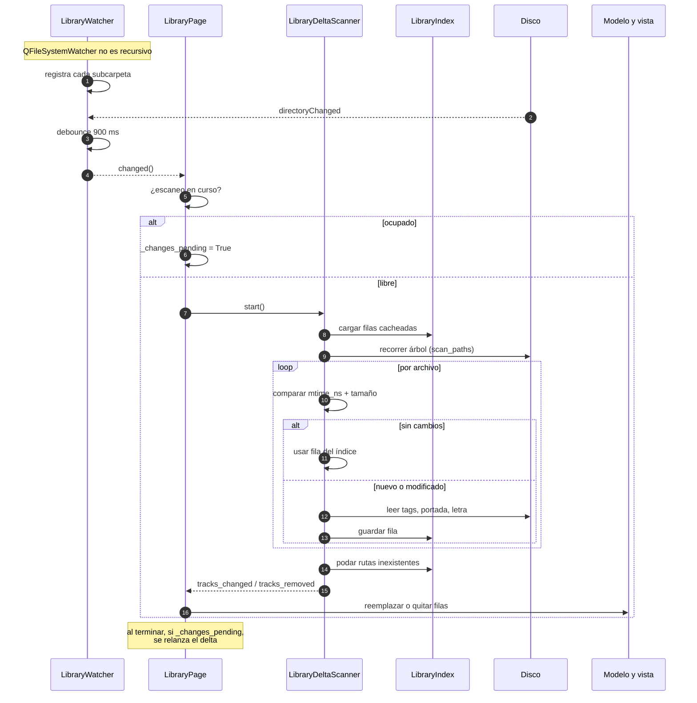
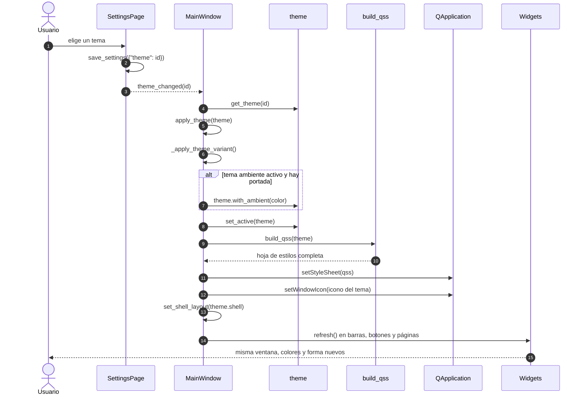

# Arquitectura

Sakura Music es una aplicación de escritorio monousuario: una ventana Qt que
orquesta procesos externos (`yt-dlp`, `ffmpeg`), lee y escribe archivos de audio
y guarda su propio estado en JSON y SQLite. No hay servidor, no hay cuentas y no
hay base de datos remota. Esta página describe cómo está partido el código, qué
corre en cada hilo y dónde vive cada dato.

## Vista de contexto



La app es el único componente con estado propio. Todo lo demás es una fuente o un
destino: YouTube y los catálogos se consultan, `ffmpeg` transforma, y el sistema
de archivos guarda el resultado.

## Capas



**La regla de dependencia va en un solo sentido:** `ui/pages` y `ui/widgets`
pueden importar `ui/services` y `core`; `ui/services` puede importar `core`;
`core` no importa nada de `ui` ni de Qt. Esa pureza es la que permite probar
`album_match`, `metadata`, `library_index` y `tag_history` sin levantar una
`QApplication`.

| Capa | Responsabilidad | No debe |
|---|---|---|
| `core/` | Modelos, parsing, tags, matching, persistencia de datos | Tocar widgets, hilos de Qt ni lanzar procesos |
| `ui/services/` | Hilos, subprocesos, señales de progreso, coordinación | Pintar ni decidir layout |
| `ui/pages/` | Componer páginas, conectar señales, validar entrada | Leer tags o lanzar `yt-dlp` directamente |
| `ui/widgets/` | Piezas reutilizables y diálogos | Guardar estado de negocio |
| `ui/theme/` | Tokens, paletas, QSS y variante ambiente | Contener lógica de páginas |

## Modelo de hilos

El hilo de la UI nunca hace trabajo pesado. Cada operación que puede tardar vive
en un `QThread` propio o en un subproceso, y se comunica por señales.



### Reglas del modelo

1. **Un servicio, un hilo.** `SearchService`, `PlaylistResolver`,
   `LibraryScanner`, `AlbumResolver`, `MetadataSearch`, `LyricsEmbedder` y
   `ThumbnailLoader` encapsulan su `QThread` y exponen señales. La página no
   hereda de `QThread`.
2. **Los subprocesos no compiten por el GIL.** `yt-dlp` y `ffmpeg` corren con
   `subprocess.Popen`, no con `QProcess`, para poder usar `CREATE_NO_WINDOW` en
   Windows y para que su trabajo de CPU no bloquee la interfaz.
3. **El estado del proceso vive en el slot.** `DownloadManager` tiene
   `MAX_CONCURRENT` slots; cada uno sabe qué `DownloadJob` y qué staging le
   corresponden. Con dos descargas en paralelo, una línea de progreso no puede
   atribuirse al trabajo equivocado.
4. **Todo servicio tiene `shutdown()`.** Cancela su hilo y espera. La limpieza se
   hace en `app.main()` después de `exec()`, no en `closeEvent`.
5. **La UI solo reacciona a señales.** No hay `sleep`, ni `wait()`, ni lectura de
   disco dentro de un `clicked`.

### Por qué el cierre es especial

`MainWindow.closeEvent` marca `_cerrando` y detiene el watcher, pero **no espera
hilos**. Si lo hiciera, un `QThread` seguiría vivo mientras Qt destruye objetos y
la salida se colgaría de forma intermitente. La secuencia correcta es:

```text
closeEvent → acepta el cierre
exec() vuelve
app.main() → window.shutdown()
              ├─ watcher.stop()
              ├─ downloads.shutdown()   (mata procesos, borra staging, guarda cola)
              ├─ search.shutdown()
              ├─ queue.shutdown()
              ├─ library.shutdown()
              └─ home_review_scanner.shutdown()
del window
```

## Persistencia

No hay una base de datos central. Cada tipo de dato tiene el formato que mejor le
sirve y todos viven bajo la carpeta de datos de la app.



| Dato | Archivo | Formato | Retención |
|---|---|---|---|
| Ajustes | `config.json` | JSON atómico (`.tmp` + `replace`) | Permanente |
| Cola | `download_queue.json` | JSON | Hasta que se limpia |
| Historial | `download_history.json` | JSON | 1000 entradas |
| Índice | `library_index.sqlite3` | SQLite WAL, `SCHEMA_VERSION = 1` | Descartable |
| Manifiestos | `Historial/*.json` | JSON por lote | 20 más nuevos |
| Portadas | `Cache/Portadas/` | PNG/JPG | Descartable |

**Los tags del archivo son la fuente de verdad.** El índice SQLite es una caché
para no releer miles de archivos en cada arranque; si se borra o se corrompe, la
biblioteca se reconstruye desde el disco. La cola y el historial son estado de la
app, no del audio: se pueden borrar sin perder música.

### Resolución de la carpeta de datos

`base_dir()` prueba `%LOCALAPPDATA%\SakuraMusic`; si detecta que la build de
Microsoft Store redirige las escrituras a `VirtualStore`, cae a
`%USERPROFILE%\SakuraMusic` y, si tampoco es visible para procesos externos, a la
carpeta temporal. La comprobación escribe una sonda y compara la ruta física con
la lógica, porque `ffmpeg` no está sandboxeado y necesita ver los mismos bytes.

## Secuencia: descarga de una canción



## Secuencia: escaneo incremental



## Secuencia: cambio de tema



## Flujo de datos de una descarga de álbum

El camino del álbum agrega dos pasos entre la búsqueda y la descarga: el catálogo
y la revisión.

```text
texto → iTunes/Deezer → AlbumEntry (título, año, género, pistas)
      → por pista: yt-dlp ytsearch5 → candidatos
      → album_match: duración + título + canal → Verdict
      → Revisar álbum (tabla editable)
      → DownloadManager.enqueue_album_track(video, candidate, carpeta)
      → al terminar: tags del catálogo + portada + folder.jpg
```

La revisión existe porque los tags salen del catálogo y quedan correctos elija el
video que elija. Si el cruce se equivoca, el archivo sale con metadata impecable y
el audio de otra canción, y eso no se detecta nunca. Por eso se ve cada elección
y su motivo antes de encolar.

## Manejo de errores

| Situación | Qué hace la app |
|---|---|
| `yt-dlp` falla | Vuelve a **PENDING** y reintenta hasta 3 veces; al final **FAILED** con mensaje traducido |
| `ffmpeg` ausente | No encola y avisa que hace falta para procesar medios |
| Catálogo sin respuesta | Cae de iTunes a Deezer; si ambos fallan, informa y no encola |
| Una pista del álbum sin match | Esa pista queda fuera; el resto sigue |
| Archivo ilegible | Se descarta del índice y se quita de la lista |
| Índice corrupto | Se ignora y se reescanea |
| JSON de config corrupto | Se usan los valores por defecto |
| Cola corrupta | Se avisa y se arranca con la cola vacía |
| Manifiesto corrupto | Se descarta y se busca el anterior |
| Portada no descargable | Se conserva la portada actual |

## Puntos de extensión

| Querés agregar… | Tocá | Cuidá |
|---|---|---|
| Un tema | `ui/theme/palettes.py` + `THEME_LIST` | Pasar `test_theme_contrast` |
| Una vista | `widgets/track_delegates.py`, `library_views.py`, `VIEW_SPECS`, `VIEW_ORDER` | El orden del stack y el de los botones deben coincidir |
| Una fuente de catálogo | `core/metadata_sources.py`, `services/metadata_search.py` | Timeouts, User-Agent y fixtures en `tests/data/` |
| Un servicio con hilo | Patrón `QObject` + `QThread` | Señales de progreso/fin/error y `shutdown()` |
| Un ajuste | `config.DEFAULTS`, `pages/settings.py` | Persistencia atómica y valor por defecto |
| Un formato | `core/formats.py` | Extensión, calidad y si transcodifica |

Los detalles de cada receta están en [desarrollo.md](desarrollo.md).
