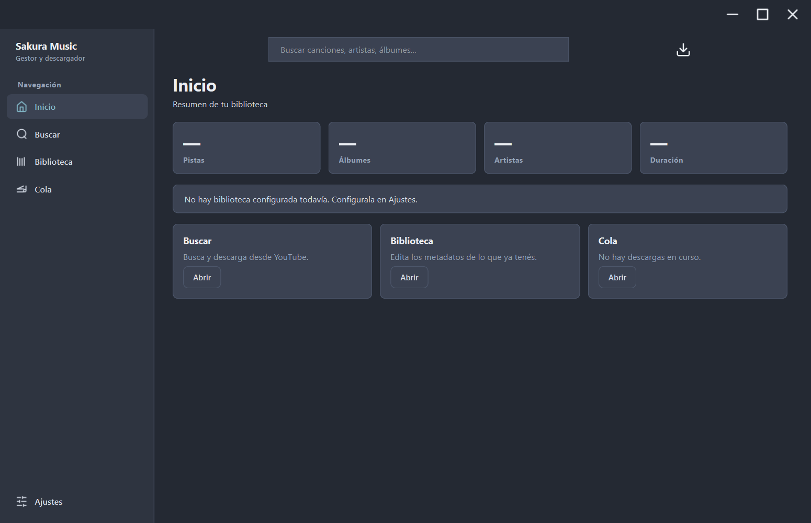

# Apariencia

Sakura Music no tiene un tema: tiene catorce, y cada uno cambia más que los
colores. Cambian las esquinas, los bordes, la tipografía de los títulos, si hay
gradientes y **cómo se organiza la navegación**.

## Cambiar de tema

1. Abrí **Ajustes** (el engranaje al pie de la barra de navegación).
2. En **Tema y diseño**, elegí un tema de la lista.
3. El cambio se aplica al instante: no hace falta reiniciar.

El tema se guarda en `config.json` y se aplica en el próximo arranque. Si el tema
guardado ya no existe, la app cae a **Sakura Premium**.

## Los catorce temas

| Tema | Navegación | Carácter |
|---|---|---|
| **Sakura Premium** | Barra lateral | Oscuro moderno con acento rosa sakura; el tema por defecto |
| **Sakura Light Airy** | Barra superior | Claro, limpio, tonos pastel y florales |
| **Editorial Warm** | Pestañas | Cálido, con jerarquía tipográfica marcada |
| **Wuxia Ink 武侠** | Riel | Tinta y papel, estética oriental sobria |
| **Fauna Silvestre** | Dock | Verde y dorado, superficies planas |
| **Fauna de Chile** | Barra inferior | Paleta terrestre, navegación abajo |
| **Anime Pop** | Doble panel | Colores saturados y panel lateral de inspector |
| **Pocket Monsters** | Barra inferior | Rojo y azul, estilo consola |
| **Cyberpunk Neon** | Barra superior | Neón sobre negro, alto contraste |
| **Nord Frost** | Barra lateral | Frío, nórdico, azules desaturados |
| **OLED Midnight** | Dock | Negro puro para pantallas OLED |
| **Catppuccin Mocha** | Riel | El popular esquema Catppuccin |
| **Emerald Forest** | Barra lateral | Verde profundo y acento claro |
| **Sunset Amber** | Barra inferior | Ámbar y naranja, cálido |

### Las siete estructuras de navegación

| Shell | Dónde vive el menú |
|---|---|
| `sidebar` | Barra lateral completa |
| `dock` | Barra lateral compacta, íconos grandes |
| `rail` | Riel angosto, solo íconos |
| `top` | Barra superior; en ese shell la barra **es** el menú |
| `tabs` | Pestañas horizontales |
| `bottom` | Barra inferior |
| `split` | Doble panel con inspector |

La estructura la declara el tema. No se elige por separado: cambiar de tema puede
mover la navegación de lugar, y eso es intencional.

## Tema desde la portada

**Ajustes → Apariencia → Cambiar el acento según la portada.**

Con esta opción activa:

1. Entrás a **Biblioteca**.
2. Seleccionás una pista.
3. El acento de la interfaz cambia al color dominante de su carátula.
4. Al salir de Biblioteca vuelve el tema base.

El cambio tiene un debounce de **220 ms** para no recolorear en cada movimiento
del mouse. Si la portada no tiene un color dominante claro, se mantiene el acento
del tema.

## Densidad

La densidad cambia el aire entre elementos, no los colores. Se ajusta desde la
barra de la Biblioteca:

| Densidad | Factor | Cuándo conviene |
|---|---|---|
| **Compacta** | 0.85 | Ver más filas en pantallas chicas |
| **Cómoda** | 1.0 | Uso general |
| **Espaciosa** | 1.15 | Pantallas grandes o lectura relajada |

El factor escala todos los paddings del QSS. No cambia el tamaño de la tipografía
base ni el de las portadas.

## Zoom

Los botones **−** y **+** de la barra de la Biblioteca cambian el tamaño de las
tarjetas y las filas entre **70 % y 160 %**, en pasos de 15. El porcentaje actual
aparece en el tooltip de cada botón.

Zoom y densidad son cosas distintas:

- **zoom** cambia el tamaño de los ítems;
- **densidad** cambia el espaciado general de la interfaz.

## Iconos personalizados

**Ajustes → Apariencia → Iconos de la interfaz → Personalizar.**

Podés reemplazar iconos por tus propios PNG:

1. Elegí un icono de la lista.
2. **Elegir imagen…** y seleccioná un PNG.
3. Decidí si querés **teñirlo con el color del tema**.
4. Mirá la **vista previa**.
5. **Listo** para aplicar.

Cada icono se puede **restaurar** individualmente o **restaurar todos**.

La app guarda una copia estable en `Iconos/`. Si movés o borrás el PNG original,
la interfaz sigue funcionando con esa copia.

## Qué cambia y qué no al cambiar de tema

| Cambia | No cambia |
|---|---|
| Colores de fondo, texto, bordes y acentos | Tu música, tags y portadas |
| Radios de esquina y grosor de bordes | La disposición de las páginas |
| Tipografía de títulos y mayúsculas | Los atajos de teclado |
| Estructura de navegación (shell) | La lógica de descargas o escaneo |
| Icono de la ventana | El tema de la portada si está apagado |

## Accesibilidad

Cada tema pasa una verificación de contraste WCAG antes de entrar:

- texto normal sobre fondo, superficie y tarjeta ≥ **4.5**;
- texto atenuado ≥ **3.0**;
- fila seleccionada ≥ **4.5**;
- botón primario y estados (error, éxito, aviso) ≥ **3.0**.

Son **12 pares por tema × 14 temas = 168 verificaciones**. Si agregás un tema y
no pasa, los tests fallan. El detalle técnico está en
[../adr/0006-temas-por-tokens.md](../adr/0006-temas-por-tokens.md).

## Atajos de navegación

| Querés… | Hacé |
|---|---|
| Inicio | `Ctrl+1` |
| Buscar | `Ctrl+2` |
| Biblioteca | `Ctrl+3` |
| Cola | `Ctrl+4` |
| Enfocar el buscador global | `Ctrl+F` |

## Problemas frecuentes

| Síntoma | Causa probable | Qué hacer |
|---|---|---|
| Un widget quedó con el color viejo | Estilo inline no refrescado | Cambiá de tema y volvé; si persiste, reportalo |
| El tema no se guarda | `config.json` sin permisos | Revisá la carpeta de datos |
| La navegación se movió | El tema nuevo usa otro shell | Es intencional; elegí un tema con el shell que prefieras |
| Un icono no cambia | El PNG no es válido o está bloqueado | Probá con otro PNG y revisá la vista previa |
| El acento no sigue la portada | La opción está apagada o la portada no tiene color dominante | Revisá Ajustes → Apariencia |

Más en [problemas.md](problemas.md).
