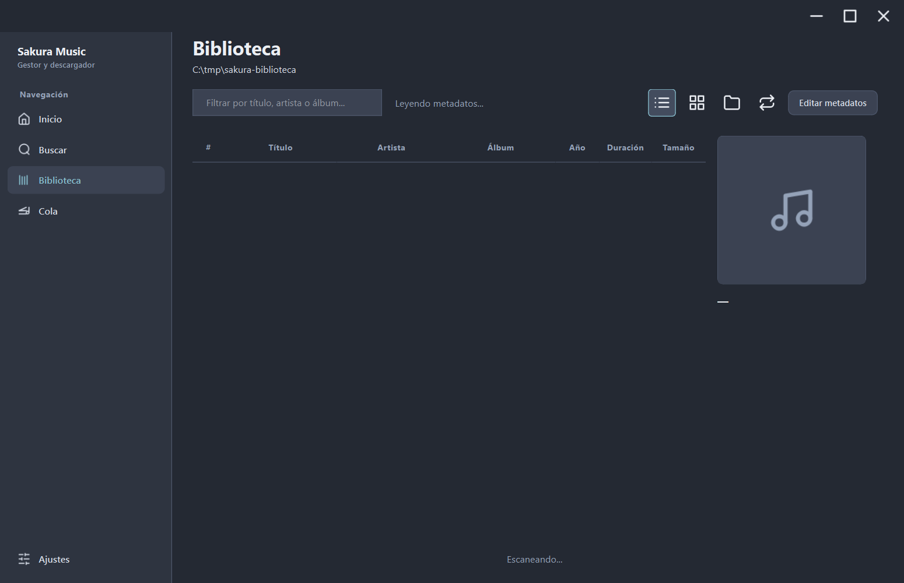

# La biblioteca

La página **Biblioteca** lista tu música local, la mantiene al día y te deja
encontrar algo rápido. No es un reproductor: es un catálogo con portadas, tags y
herramientas para ordenar.

## Primer escaneo

La primera vez que entrás a Biblioteca, la app recorre la carpeta configurada y
lee los tags de cada archivo. Eso puede tardar unos segundos si tenés miles de
pistas.

Mientras escanea:

- la lista se llena por tandas, sin esperar al final;
- podés seguir usando el resto de la app;
- al terminar ves el resumen: `N pistas · N álbumes · N artistas · N h`.

### Qué lee de cada archivo

| Dato | De dónde sale |
|---|---|
| Título, artista, álbum, año, género, número de pista | Tags del archivo (mutagen) |
| Duración, formato, tamaño | Archivo y `ffprobe`/mutagen |
| Portada | Tag embebido, `folder.jpg`, `cover.*` o placeholder dibujado |
| Letra | `.lrc`/`.txt` junto al audio o tag incrustado |

La portada y la letra se resuelven **una vez por carpeta**, no una vez por pista.
En un álbum de 14 temas, `folder.jpg` se busca una sola vez.

### El índice

La app guarda un índice SQLite con la ruta, el `mtime_ns` y el tamaño de cada
archivo. En el próximo arranque solo relee lo que cambió. Si el índice se borra o
se corrompe, no pasa nada: se reconstruye desde el disco.

## Mantenimiento automático

Después del primer escaneo, la app vigila la carpeta y todas sus subcarpetas. Si
copiás un álbum, lo borrás o lo editás por fuera:

1. El watcher detecta el cambio.
2. Espera **900 ms** para agrupar la tanda (copiar un álbum dispara decenas de
   avisos).
3. Compara el disco contra el índice y relee solo las altas y modificaciones.
4. Quita del modelo las rutas que ya no existen.

Si llega un cambio mientras hay un escaneo en curso, se reintenta al terminar. No
perdés el aviso.

## Las dos secciones

| Sección | Qué muestra |
|---|---|
| **Canciones** | Todas las pistas de la biblioteca, con la vista que elijas |
| **Carpetas** | El árbol de carpetas, con chips de subcarpetas y migas de pan |

La sección cambia **el contenido**; la vista cambia **la presentación**.

En **Carpetas**:

- los chips muestran las subcarpetas de la carpeta actual;
- las migas de pan son clicables: podés volver a cualquier nivel;
- **Volver** sube un nivel;
- la navegación se oculta cuando no hay una carpeta abierta fuera de la raíz.

## Las seis vistas

| Vista | Ideal para |
|---|---|
| **Tabla** | Ver y ordenar por columnas: título, artista, álbum, año, duración, tamaño |
| **Cuadrícula** | Tarjetas con portada, título y artista |
| **Mosaico** | La carátula manda y el texto queda debajo |
| **Estantería de álbumes** | Agrupar por álbum, como una pila de fundas |
| **Discos de vinilo** | Ver tus álbumes como discos con surcos e ilustración central |
| **Carrusel** | Navegación horizontal con perspectiva |

### Ocultar vistas

Clic derecho sobre un botón de vista abre un menú:

- **Ocultar “Vista X” de la barra**;
- **Mostrar todas las vistas**.

Siempre queda al menos una visible: la app no te deja esconder la última.

## Buscar, ordenar y filtrar

La barra de la Biblioteca tiene:

| Control | Qué hace |
|---|---|
| **Buscador** | Filtra por título, artista o álbum mientras escribís |
| **Chips** | **Todos / Sin tags / Sin portada / Duplicados** |
| **Contador** | Muestra cuántas pistas, álbumes, artistas y horas hay |
| **Vistas** | Cambia entre las seis presentaciones |
| **Zoom** | Ajusta el tamaño entre 70 % y 160 %, en pasos de 15 |
| **Densidad** | Compacta (0.85), Cómoda (1.0) o Espaciosa (1.15) |
| **Carpeta** | Cambia la carpeta de la biblioteca |
| **Volver a escanear** | Fuerza un escaneo completo |
| **Deshacer último lote** | Revierte la última edición de tags en lote |

### Los chips de revisión

| Chip | Qué muestra |
|---|---|
| **Todos** | Sin filtro |
| **Sin tags** | Pistas con título o artista vacíos o desconocidos |
| **Sin portada** | Pistas sin carátula embebida ni de carpeta |
| **Duplicados** | Pistas con el mismo artista y título tras normalizar |

Dos pistas son duplicadas si comparten artista y título después de pasar a
minúsculas, quitar acentos y puntuación. Las pistas de artista desconocido no
participan.

Cuando un chip está activo, aparece **Ver toda la biblioteca** para volver al
filtro normal.

### Ordenar

En la vista de tabla, clic en el encabezado de una columna ordena por esa columna.
Un segundo clic invierte el orden. Los valores vacíos van al final, no al
principio: un álbum sin año no debería encabezar la lista.

## El panel de detalle

Al seleccionar una pista, el panel derecho muestra:

- portada grande;
- título y artista;
- álbum, año, género y número de pista;
- si tiene letra;
- formato, duración y tamaño;
- la ruta del archivo.

Desde ahí podés:

- **Editar metadatos**;
- **Buscar e incrustar letra**;
- abrir la **información de la pista** con todos los datos y un botón para copiar
  la ruta.

Doble clic en una fila abre la ficha completa de la pista.

## Selección múltiple

Al marcar más de una pista aparece una barra de selección con:

| Acción | Qué hace |
|---|---|
| **Editar metadatos** (una pista) | Abre el editor individual |
| **Editar en lote** (varias) | Aplica campos a todas las seleccionadas |
| **Incrustar letras** | Busca e incrusta letras en lote |
| **Quitar selección** | Limpia la selección |

El detalle de estas acciones está en
[metadatos-y-letras.md](metadatos-y-letras.md).

## Tema desde la portada

Si **Cambiar el acento según la portada** está activo en Ajustes, al seleccionar
una pista el acento de la interfaz cambia al color dominante de su carátula.
Tiene un debounce de **220 ms** para no recolorear en cada movimiento.

Al salir de Biblioteca vuelve el tema base. Se apaga desde **Ajustes →
Apariencia**.

## Vista previa de portada

En las vistas de tarjetas, al pasar el mouse sobre una pista aparece una
previsualización de la portada. Se oculta sola al salir.

## La biblioteca está vacía

Si no hay música, ves un estado vacío con el botón **Importar carpeta**. Si la
carpeta configurada no existe, la app avisa **No se encontró la carpeta** y no
escanea.

## Atajos de la página

| Querés… | Hacé |
|---|---|
| Ir a Biblioteca | `Ctrl+3` |
| Enfocar el buscador global | `Ctrl+F` |
| Volver a Inicio | `Ctrl+1` |

## Problemas frecuentes

| Síntoma | Qué revisar |
|---|---|
| No aparece una pista nueva | Esperá 1 segundo (debounce) o pulsá **Volver a escanear** |
| Una pista aparece dos veces | Revisá el chip **Duplicados**; pueden ser dos archivos distintos |
| No se ve la portada | El archivo no tiene tag de portada ni `folder.jpg`/`cover.*` |
| El contador no coincide con el disco | Puede haber archivos ilegibles o con extensión no soportada |
| La vista no cambia | Revisá si la vista está oculta; clic derecho → **Mostrar todas las vistas** |

Más en [problemas.md](problemas.md).
