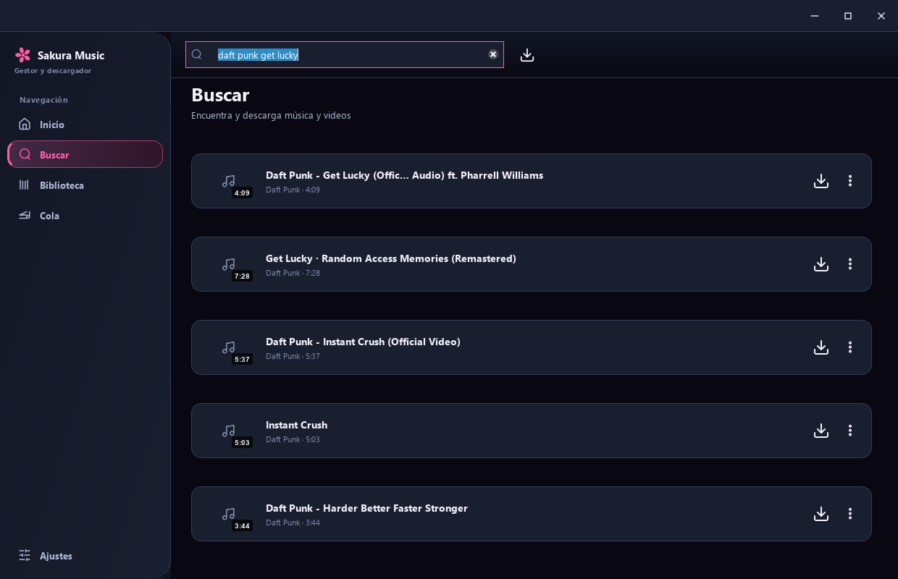
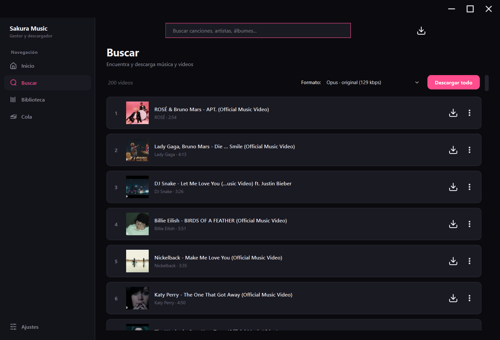
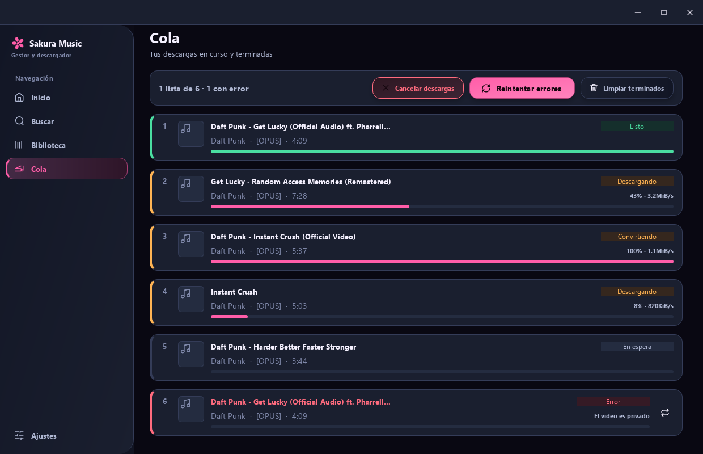

# Buscar y descargar

La página **Buscar** es la puerta de entrada de la app. Desde ahí se busca en
YouTube, se resuelven playlists y se traen álbumes completos del catálogo. Todo lo
que se encola aparece en **Cola**.







## Buscar por texto

1. Escribí un título, un artista o una parte de la letra.
2. Esperá: la app agrupa las pulsaciones y lanza la búsqueda **450 ms** después
   de la última tecla.
3. Aparecen hasta **20 resultados** con portada, título, canal, duración y vistas.

Atajos útiles:

| Querés… | Hacé |
|---|---|
| Ir a Buscar | `Ctrl+2` o **Buscar** en la barra lateral |
| Enfocar el buscador global | `Ctrl+F` |
| Volver a Inicio | `Ctrl+1` |
| Ir a Biblioteca | `Ctrl+3` |
| Ir a Cola | `Ctrl+4` |

La búsqueda por texto **no numera** los resultados: el orden lo decide YouTube
por relevancia. La numeración aparece en playlists y en la cola.

## Elegir formato y calidad

En la barra de Buscar hay un selector **Formato**. El valor inicial sale de
**Ajustes**, pero podés cambiarlo para una descarga puntual.

### Audio

| Formato | Qué hace | Cuándo conviene |
|---|---|---|
| **Opus · original** | Remux del stream original, sin recodificar | Uso general; el archivo más chico y sin pérdida generacional |
| **m4a · AAC 192 kbps** | Recodifica a AAC | Compatibilidad amplia con reproductores y teléfonos |
| **mp3 · 320 kbps** | Recodifica a MP3 | Cuando el destino solo acepta MP3 |

### Video

| Formato | Resolución |
|---|---|
| **MP4 · Mejor calidad** | La máxima disponible (1080p o más) |
| **MP4 · 1080p** | Full HD |
| **MP4 · 720p** | HD |
| **MP4 · 480p** | SD |
| **MP4 · 360p** | Baja |

El video se mezcla con ffmpeg: el archivo final es un MP4 con audio incluido.

## Descargar una canción

1. Pulsá el botón de descarga de la tarjeta.
2. Si es la primera descarga y falta ffmpeg, la app avisa y no encola nada.
3. La app salta a **Cola** y muestra el trabajo.

Antes de lanzar el proceso, la app revisa duplicados:

- si el mismo video ya está pendiente o descargándose, el trabajo queda **Ya
  estaba** con el motivo “Ya está en la cola de descarga”;
- si el archivo ya existe en la biblioteca o en la carpeta de descargas, queda
  **Ya estaba** con “Ya está en tu biblioteca”.

Un lote compuesto solo por duplicados no abre la ventana de resumen.

## Descargar una playlist

1. Pegá una URL de playlist de YouTube:
   - `https://www.youtube.com/playlist?list=...`
   - `https://www.youtube.com/watch?v=...&list=...`
   - `https://music.youtube.com/playlist?list=...`
2. La app la detecta sola y extrae el listado completo mediante `yt-dlp` a través del backend en Rust.
3. Se abre el panel interactivo de la playlist con título, creador, cantidad de pistas y miniaturas.
4. Podés seleccionar o deseleccionar pistas individuales con las casillas, o usar **Seleccionar Todas**.
5. Activá o desactivá **«Organizar en subcarpeta dedicada»** para agrupar todas las canciones en su propia carpeta.
6. Elegí el formato deseado (Opus, MP3, FLAC, M4A) y pulsá **Descargar N Canciones**.
7. La app encola todas las canciones simultáneamente en la pestaña **Cola de Descargas** con monitoreo de progreso y velocidad en vivo.

Los archivos quedan en **una sola carpeta** con el nombre de la playlist, dentro
de la biblioteca:

```text
Biblioteca\
  Mi playlist\
    01 - Tema uno.opus
    02 - Tema dos.opus
```

No se dispersan por artista: una playlist de 30 temas de 12 artistas quedaría
imposible de encontrar.

## Traer un álbum del catálogo

Este camino es distinto: los tags salen del catálogo, no del video. Sirve para
que un disco quede con álbum, año, género y número de pista correctos.

1. Hacé una búsqueda normal y esperá a tener resultados.
2. Pulsá **Traer álbum del catálogo**.
3. La app busca el álbum en iTunes (y cae a Deezer si iTunes no devuelve nada),
   elige el grupo con más pistas y ordena por número.
4. Busca **cada pista** en YouTube, con 5 resultados por pista. El estado muestra
   “Buscando 3 de 12…”.
5. Se abre **Revisar álbum** con esta información por fila:

   | Columna | Qué muestra |
   |---|---|
   | **Usar** | Casilla para incluir o no la pista |
   | **Nº** | Número de pista del álbum |
   | **Pista del álbum** | Título según el catálogo |
   | **Video elegido** | Video de YouTube que se va a bajar |
   | **Duración** | Duración del video |
   | **Estado** | `Coincide`, `Revisar` o `Sin match`, con el motivo |

6. Revisá, desmarcá lo que no quieras y pulsá **Descargar lo elegido**.

Las pistas `Sin match` no se pueden marcar. El cruce descarta compilaciones,
mixes, directos, karaoke, covers, nightcore y videos de más de 15 minutos. La
tolerancia de duración es de 12 segundos; a partir de 25 se marca como dudosa.

Al terminar cada descarga, la app escribe los tags del catálogo, descarga la
portada, la incrusta y —si el ajuste está activo— deja un `folder.jpg` en la
carpeta del álbum.

## Elegir un álbum desde la discografía

Si no sabés el nombre exacto del disco:

1. Buscá el artista.
2. Pulsá **Ver álbumes del artista**.
3. La app busca el artista en iTunes y muestra sus discos del más nuevo al más
   viejo, con año, género y cantidad de pistas.
4. El filtro **Solo álbumes completos** viene activado. Usa el nombre y la
   cantidad de pistas: cuatro o más es un disco; tres es un maxi single. Apagalo
   para ver singles, EPs y remixes.
5. Elegí un álbum y seguí el mismo camino de revisión que el apartado anterior.

## La cola

La cola muestra cada trabajo con su estado, progreso, velocidad y, si terminó, la
ruta del archivo.

| Estado | Significado |
|---|---|
| **Pendiente** | Esperando un slot libre |
| **Descargando** | yt-dlp está trabajando |
| **Convirtiendo** | ffmpeg está mezclando o recodificando |
| **Lista** | Archivo movido a destino |
| **Ya estaba** | Duplicado o archivo existente |
| **Con error** | Falló después de los reintentos |
| **Cancelada** | La cancelaste vos |

### Acciones

| Botón | Qué hace |
|---|---|
| **Reintentar esta descarga** (ícono por fila) | Vuelve a encolar un trabajo con error o cancelado |
| **Reintentar errores** | Reencola todos los que están en error |
| **Cancelar descargas** | Cancela todo lo pendiente o en curso, con confirmación |
| **Limpiar terminados** | Saca de la vista los trabajos con estado final |
| **Historial** | Abre el registro de descargas terminadas |

Un trabajo que falla se reintenta hasta **3 veces** automáticamente. Entre
intentos se borra la carpeta temporal `Descargas/job-XXXX`. Recién al tercer
fallo queda **Con error**.

**Limpiar terminados no renumera la cola.** Los números quedan estables para que
puedas seguir hablando de “la descarga 7” sin confusión.

### Reanudar al abrir

La cola se guarda en `download_queue.json` cada vez que cambia un estado. Si
cerrás la app con descargas pendientes, al volver:

- los trabajos pendientes siguen pendientes;
- los que estaban en curso vuelven como **Pendiente**, con el motivo “Descarga
  interrumpida al cerrar la aplicación”;
- la app los relanza sola en los slots libres.

### Resumen final

Cuando no queda nada pendiente ni en curso, aparece un resumen con cuatro cifras:
**descargadas**, **con error**, **ya estaban** y **canceladas**. Desde ahí podés
volver a la cola o cerrar.

## Historial de descargas

El historial guarda el resultado final de cada trabajo aunque ya no esté en la
cola:

- estado (descargada, con error, ya estaba, cancelada);
- fecha y motivo;
- formato y ruta.

Se puede filtrar por estado y buscar por texto. Conserva las **1000 entradas más
recientes**. Si un trabajo falla y después se reintenta con éxito, la entrada se
reemplaza, no se duplica.

**Borrar historial** pide confirmación y elimina el archivo.

## Qué hacer si una descarga falla

1. Leé el motivo en la fila de la cola.
2. Revisá la tabla de [problemas.md](problemas.md).
3. Si el error es temporal, reintentá.
4. Si el video es privado o tiene restricción de edad, configurá cookies de
   navegador en **Ajustes → Descargas**.

Los errores habituales están traducidos: video privado, no disponible,
restricción de edad, problema de red, ffmpeg faltante.
