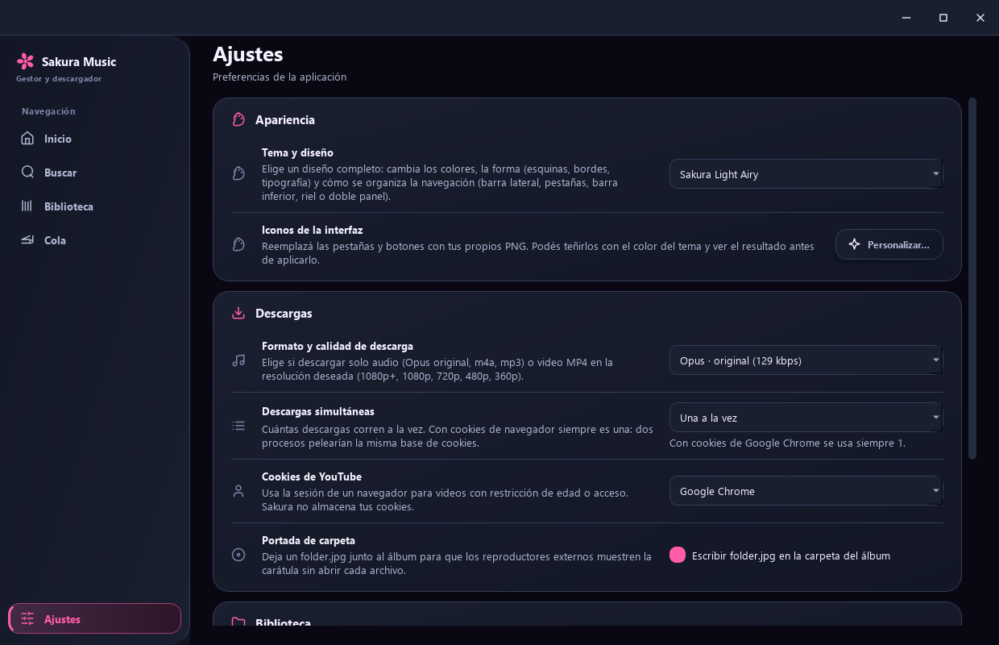

# Instalación y primer arranque

Sakura Music es una app de escritorio. Se instala con `pip`, necesita **ffmpeg**
para procesar audio y video, y guarda todo lo suyo en una carpeta de datos del
usuario.

## Lo que necesitás

| Requisito | Para qué | Cómo se resuelve |
|---|---|---|
| **Python 3.12 o superior** | Correr la app | [python.org](https://www.python.org/downloads/) o el Python de tu sistema |
| **PySide6, yt-dlp y mutagen** | Interfaz, descargas y tags | Los instala `pip` con el proyecto |
| **ffmpeg y ffprobe** | Convertir, mezclar y verificar medios | En el `PATH` o en `%LOCALAPPDATA%\SakuraMusic\bin` |
| **Conexión a YouTube** | Buscar y descargar | — |

`yt-dlp` viene como dependencia de Python. `ffmpeg` no: es un binario aparte y la
app no lo puede instalar sola sin permiso del sistema. Si falta, la app avisa y
no encola descargas.

## Instalar

Desde la raíz del repositorio:

```bash
python -m pip install -e .
```

Eso deja el comando `sakura-music` disponible y permite ejecutar el paquete con
`python -m sakura`.

Para desarrollo, con tests y lint:

```bash
python -m pip install -e .[dev]
```

## Instalar ffmpeg

**Opción rápida en Windows** (si tenés `winget`):

```bash
winget install Gyan.FFmpeg
```

**Opción manual:** descargá un build de [ffmpeg.org](https://ffmpeg.org/download.html),
descomprimilo y dejá `ffmpeg.exe` y `ffprobe.exe` en:

```text
%LOCALAPPDATA%\SakuraMusic\bin\
```

La app busca primero en el `PATH` y después en esa carpeta. También puede
actualizarlo desde **Ajustes → Herramientas**, que usa `winget` cuando está
disponible.

## Abrir la app

```bash
python -m sakura
```

En Windows también podés usar **`SakuraMusic.pyw`**: arranca con `pythonw.exe`,
sin consola, y muestra el launcher visual.

| Querés… | Hacé |
|---|---|
| Entrar directo a la ventana principal | `python -m sakura --no-launcher` |
| Saltear el launcher por variable | `SAKURA_NO_LAUNCHER=1` |
| Saltear el splash | `SAKURA_NO_SPLASH=1` |
| Diagnosticar un cuelgue | `SAKURA_TRACE=1` (vuelca la pila a los 6 s) |

### Launcher o ventana directa

Con el launcher activo vas a ver:

- **Biblioteca:** cuántas pistas y álbumes hay.
- **Cola:** trabajos pendientes o el aviso de que se reanuda al abrir.
- **Herramientas:** si FFmpeg está detectado y qué versión de yt-dlp tenés.
- **Abrir Sakura:** entra a la ventana principal.

El launcher **no escanea audio ni lanza procesos**: solo lee lo que ya está
guardado. Si querés evitar ese paso, usá `--no-launcher`.

## Acceso directo con icono

Windows no permite embeber un icono en un `.pyw`. Para tener el acceso directo
con el icono de Sakura en el Escritorio y en el Menú Inicio:

```bash
python scripts/create_launcher_shortcut.py
```

Si querés regenerar el `.ico` desde el logo:

```bash
python scripts/make_app_icon.py
```

## Dónde quedan tus datos

Por defecto, en Windows:

```text
%LOCALAPPDATA%\SakuraMusic\
  config.json
  download_queue.json
  download_history.json
  library_index.sqlite3
  Musica\            ← biblioteca por defecto
  Descargas\         ← staging de descargas
  Cache\Portadas\    ← miniaturas
  Historial\         ← manifiestos para deshacer tags
  Iconos\            ← copias de los PNG personalizados
```

Si la build de Microsoft Store de Python redirige `%LOCALAPPDATA%` a un
`VirtualStore` que ffmpeg no puede ver, la app detecta la redirección y usa
`%USERPROFILE%\SakuraMusic`. En el peor caso, cae a la carpeta temporal.

Podés cambiar la carpeta de la biblioteca y la de descargas desde **Ajustes**.

## Primer recorrido

1. Abrí **Ajustes** y elegí:
   - el **tema** que te guste;
   - el **formato de descarga** (opus por defecto);
   - la **carpeta de biblioteca** si no querés usar `Musica`;
   - el **navegador para cookies** solo si vas a bajar contenido restringido.



2. Andá a **Buscar**, escribí un artista o un título y esperá los resultados.
3. Pulsá el botón de descarga de una tarjeta.
4. Mirá el avance en **Cola**.
5. Cuando termine, abrí **Biblioteca** para ver la pista con su portada y sus
   tags.

Los siguientes pasos están en [buscar-y-descargar.md](buscar-y-descargar.md) y
[biblioteca.md](biblioteca.md).

## Desinstalar

1. `python -m pip uninstall sakura-music`
2. Borrá la carpeta de datos (`%LOCALAPPDATA%\SakuraMusic`) **solo si** querés
   perder ajustes, cola, historial e índice. Tu música no vive ahí salvo que hayas
   dejado la biblioteca en `Musica\`.
3. Si creaste accesos directos, borralos del Escritorio y del Menú Inicio.

## Si algo no arranca

| Síntoma | Causa probable | Qué hacer |
|---|---|---|
| “No module named sakura” | No instalaste el paquete | `python -m pip install -e .` |
| “ffmpeg no está instalado” | Falta el binario | Instalalo en el `PATH` o en `bin\` |
| La ventana no aparece | `QT_QPA_PLATFORM=offscreen` activo | Quitá esa variable |
| Se cierra sin mensaje | Error de un hilo al salir | Probá `SAKURA_TRACE=1` y mirá `close_hang.txt` |
| No descarga videos restringidos | YouTube pide sesión | Configurá cookies de navegador en Ajustes |

Más casos en [problemas.md](problemas.md).
