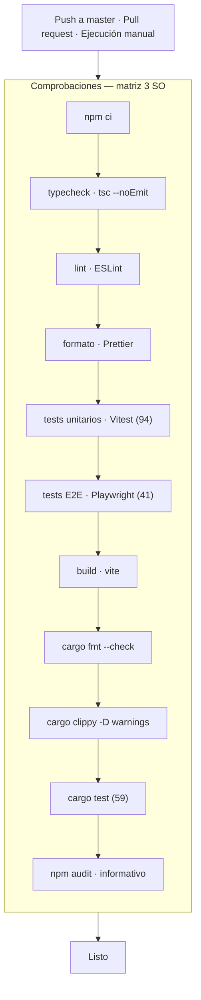

# Pipeline de Sakura Music

Representación visual de `.github/workflows/ci.yml`. La fuente de verdad es ese
archivo; este documento es el mapa para leerlo de un vistazo. El CI **no genera
instaladores, actualizadores ni artefactos de release**: compila y ejecuta tests
en tres plataformas. El porqué está en
[racional-de-decisiones.md](racional-de-decisiones.md#9-sin-instalador-actualizador-ni-firma).

## Diagrama

## Etapas

| # | Etapa | Comando | Bloquea | Qué valida |
|---|---|---|---|---|
| 1 | Instalar | `npm ci` | sí | Lockfile reproducible |
| 2 | Tipos | `npm run typecheck` | sí | `strict` + `noUnusedLocals` del frontend |
| 3 | Lint | `npm run lint` | sí | React Hooks y reglas de TypeScript |
| 4 | Formato | `npm run format:check` | sí | Prettier en TS/TSX/JS/JSON/YAML |
| 5 | Unitarios | `npm test` | sí | 94 tests: cola persistida, toast de deshacer, contrato IPC y `ErrorBoundary` |
| 6 | E2E | `npm run test:e2e` | sí | 41 tests: arranque, splash, siete pestañas, paleta ⌘K, teclado, los cinco temas nuevos y snapshots de los 8 temas del loop visual |
| 7 | Build | `npm run build` | sí | `tsc` + bundle de producción |
| 8 | Formato Rust | `cargo fmt --check` | sí | `rustfmt.toml` |
| 9 | Lint Rust | `cargo clippy -D warnings` | sí | 0 avisos |
| 10 | Tests Rust | `cargo test` | sí | 59 pruebas (incluye migraciones, playlists y lyrics) |
| 11 | Auditoría | `npm run audit` | **no** | `picomatch`: aviso *high* sin corrección |

Las etapas 1–11 corren en **Windows, macOS y Linux** (matriz de 3 SO), con
`actions/checkout@v7`, `actions/setup-node@v7` y `actions/upload-artifact@v7`.
No hay etapa de empaquetado ni de firma.

> Nota de build: `src-tauri/Cargo.toml` fija `[profile.dev] debug = 0`. MSVC se
> topaba con el error D8050 cuando los target paths largos incluían información
> de debug completa; si necesitás símbolos, usá un profile explícito, pero no
> cambies el default del pipeline.

> Nota de caché: el workflow fija `CARGO_INCREMENTAL: '0'` a nivel de `env`.
> Las runners son descartables y el código cambia en cada push, así que la
> compilación incremental apenas acelera el CI y en cambio acumula sesiones que
> inflan el caché de `Swatinem/rust-cache@v2`. Esto **no afecta al desarrollo
> local**: `npm run tauri dev` mantiene el incremental activo. El aviso de
> *hardlinking* que aparece en Windows es local (ruta `D:\Proyectos\...`), no
> de las runners; si `target\debug\incremental` crece demasiado en la máquina,
> se puede limpiar sólo esa carpeta sin borrar el resto de `target/`.

`npm run pipeline` ejecuta las etapas bloqueantes en orden y hoy pasa en verde.

## Cómo verlo

- **En local, de un vistazo:** este documento.
- **En local, ejecutándolo:** `npm run pipeline` (corre todas las etapas bloqueantes en orden).
- **En GitHub:** suba el repo y acceda a *Actions → CI*. Cada push a `master`
  lanza las tres comprobaciones; no hay job manual de release.

## Convenciones

- Si agregás una etapa, sumala al workflow, a la tabla y al diagrama en el mismo commit.
- Un paso `continue-on-error: true` debe explicarse en la columna "Bloquea" y en el propio YAML.
- No se reintroducen secretos de firma ni artefactos de instalación sin una
  decisión explícita registrada como ADR nuevo.
