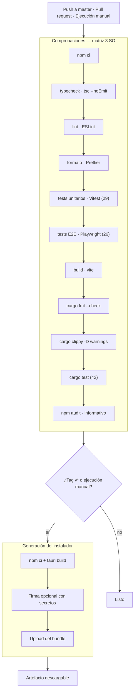

# Pipeline de Sakura Music

Representación visual de `.github/workflows/ci.yml`. La fuente de verdad es ese archivo; este documento es el mapa para leerlo de un vistazo.

## Diagrama

## Etapas

| # | Etapa | Comando | Bloquea | Qué valida |
|---|---|---|---|---|
| 1 | Instalar | `npm ci` | sí | Lockfile reproducible |
| 2 | Tipos | `npm run typecheck` | sí | `strict` + `noUnusedLocals` del frontend |
| 3 | Lint | `npm run lint` | sí | React Hooks y reglas de TypeScript |
| 4 | Formato | `npm run format:check` | sí | Prettier en TS/TSX/JS/JSON/YAML |
| 5 | Unitarios | `npm test` | sí | 29 tests: cola persistida, toast de deshacer y `ErrorBoundary` |
| 6 | E2E | `npm run test:e2e` | sí | 28 tests: arranque, splash, 6 pestañas, paleta ⌘K y teclado |
| 7 | Build | `npm run build` | sí | `tsc` + bundle de producción |
| 8 | Formato Rust | `cargo fmt --check` | sí | `rustfmt.toml` |
| 9 | Lint Rust | `cargo clippy -D warnings` | sí | 0 avisos |
| 10 | Tests Rust | `cargo test` | sí | 43 pruebas (incluye migraciones, playlists y lyrics) |
| 11 | Auditoría | `npm run audit` | **no** | `picomatch`: aviso *high* sin corrección |
| 12 | Instalador | `npm run tauri build` | sí | Sólo con tag o manual |

Las etapas 1–11 corren en **Windows, macOS y Linux** (matriz de 3 SO). La 12
sólo en Windows y usa los secrets de firma del updater.

> Nota de build: `src-tauri/Cargo.toml` fija `[profile.dev] debug = 0`. MSVC se
> topaba con el error D8050 cuando los target paths largos incluían información
> de debug completa; si necesitás símbolos, usá un profile explícito, pero no
> cambies el default del pipeline.

`npm run pipeline` ejecuta las etapas bloqueantes en orden y hoy pasa en verde.

## Cómo verlo

- **En local, de un vistazo:** este documento.
- **En local, ejecutándolo:** `npm run pipeline` (corre todas las etapas bloqueantes en orden).
- **En GitHub:** subí el repo y entrá a *Actions → CI*. El job del instalador se lanza con *Run workflow* o con un tag `vX.Y.Z`.

## Convenciones

- Si agregás una etapa, sumala al workflow, a la tabla y al diagrama en el mismo commit.
- Un paso `continue-on-error: true` debe explicarse en la columna "Bloquea" y en el propio YAML.
- Los secretos de firma se documentan en [release.md](release.md); nunca van en el repositorio.
