# Por qué Sakura Music es así

Este documento responde a las preguntas que surgen al leer el código:
**¿por qué este lenguaje?, ¿por qué se hizo de esta forma y no de otra?**
No reemplaza a los [ADRs](adr/README.md): los ADRs registran cada decisión
importante de forma formal y atómica; acá se cuenta el hilo conductor en
lenguaje directo y se enlaza el ADR correspondiente cuando existe.

Cuando una decisión nueva cambia el rumbo, se agrega un ADR nuevo en vez de
reescribir los viejos. Las cifras históricas de los ADRs se conservan; la cifra
vigente de temas es **19**.

## Cómo leer cada apartado

Todos los temas siguen la misma estructura para que se puedan comparar:

| Campo | Qué responde |
|---|---|
| **Decisión** | Qué se eligió y qué alternativa queda descartada en un vistazo |
| **Por qué** | El problema concreto que resolvía |
| **Alternativas descartadas** | Lo que se probó o se evaluó y por qué no sirvió |
| **Consecuencia** | Qué implica mantener esa decisión hoy |
| **Reflejo en el código** | Dónde verificarla |

## Mapa de decisiones

```mermaid
flowchart TB
    RA["Por qué Sakura Music es así"]
    RA --> F["Fundamentos"]
    RA --> I["Identidad visual"]
    RA --> D["Datos y flujos"]
    RA --> X["Interfaz y control"]
    RA --> Q["Ingeniería y calidad"]

    F --> F1["§1 lenguaje y stack"]
    F --> F2["§2 local-first"]
    F --> F3["§3 SQLite + FTS5"]
    F --> F11["§11 tags del archivo"]

    I --> I1["§4 temas data-skin"]
    I --> I2["§5 bibliotecas únicas"]
    I --> I3["§8 recursos locales"]

    D --> D1["§12 yt-dlp / ffmpeg"]
    D --> D2["§13 cola persistente"]
    D --> D3["§14 playlists"]
    D --> D4["§15 papelera y deshacer"]
    D --> D5["§16 letras LRC"]

    X --> X1["§6 control remoto"]
    X --> X2["§7 notificaciones"]
    X --> X3["§17 validación IPC"]
    X --> X4["§18 paleta de comandos"]
    X --> X5["§19 presentación y PNG"]

    Q --> Q1["§9 sin instalador"]
    Q --> Q2["§10 módulos y lazy"]
    Q --> Q3["§20 miniaturas"]
```

## Índice

| Bloque | Apartados |
|---|---|
| Fundamentos | [§1 lenguaje](#s1) · [§2 local-first](#s2) · [§3 persistencia](#s3) · [§11 tags](#s11) |
| Identidad | [§4 temas](#s4) · [§5 bibliotecas](#s5) · [§8 recursos](#s8) |
| Datos y flujos | [§12 herramientas](#s12) · [§13 cola](#s13) · [§14 playlists](#s14) · [§15 papelera](#s15) · [§16 letras](#s16) |
| Interfaz y control | [§6 remoto](#s6) · [§7 notificaciones](#s7) · [§17 IPC](#s17) · [§18 paleta](#s18) · [§19 presentación](#s19) |
| Ingeniería | [§9 release](#s9) · [§10 organización](#s10) · [§20 miniaturas](#s20) |
| Cierre | [§21 decisiones retiradas](#s21) · [§22 principios](#s22) · [§23 rendimiento de Sakura](#s23) · [Resumen](#resumen) |

---

## 1. Lenguaje y stack: Rust en el motor, React en la interfaz

**Decisión.** Tauri 2 + Rust en el backend y React 19 + TypeScript + Tailwind
en el frontend (ver [ADR 0009](adr/0009-migracion-tauri-2-rust.md)).

**Por qué.** La versión 1.0 estaba en Python/PySide6. El GIL de Python limitaba
el escaneo paralelo de bibliotecas grandes y la distribución de virtualenvs era
pesada. Rust permite indexar con `rayon`/`walkdir` en todos los núcleos, leer y
editar tags con `lofty` sin bloquear archivos en Windows, y entregar un binario
que arranca rápido. React permite que cada tema redibuje estructuras completas
sin pelear con QSS.

**Alternativas descartadas.** Seguir con PySide6 (mismo cuello de botella) y
Electron (bundle mucho más grande para el mismo resultado).

**Consecuencia.** El desarrollo requiere compilador de Rust, pero el usuario
final no instala Python ni dependencias del lenguaje.

**Reflejo en el código.** `src-tauri/src/scanner.rs`, `src-tauri/src/downloader.rs`,
`src/App.tsx` y `legacy_python/` como referencia histórica.

---

## 2. Local-first: sin login, sin backend, sin streaming

**Decisión.** La app funciona 100 % en la máquina del usuario: no hay cuentas,
no hay servidor propio, no hay base de datos remota y no reproduce música en
streaming. YouTube es sólo una fuente desde la que se descarga con `yt-dlp`;
los catálogos (iTunes, Deezer, MusicBrainz) se consultan sólo para metadatos.

**Por qué.** La promesa del proyecto es que la biblioteca es del usuario y
sigue funcionando sin conexión. Meter login o streaming convertiría la app en
un servicio y abandonaría esa promesa. El audio se reproduce desde Blob URLs
locales, así se pueden editar tags o carátulas mientras suena.

**Alternativas descartadas.** Un servidor con sincronización y un reproductor
que hiciera streaming directo: ambos rompen el funcionamiento offline y obligan
a gestionar identidad y sesiones.

**Consecuencia.** No hay registro, no hay contraseñas y no hay datos del usuario
fuera de su disco. La privacidad es una propiedad del diseño, no una opción.

**Reflejo en el código.** `src/App.tsx`, `src-tauri/src/lib.rs` y `src/lib/puente.ts`.

---

## 3. Persistencia: SQLite con FTS5, no Postgres ni MySQL

**Decisión.** La biblioteca vive en `library.sqlite3`, con índice FTS5 para
búsquedas, `user_version=2` para migraciones y respaldos (ver
[ADR 0016](adr/0016-migraciones-y-hardening-bd.md)).

**Por qué.** Es una app de un solo usuario y un solo equipo. SQLite es embebido,
no necesita proceso de servidor, ocupa un archivo y se puede copiar entero para
la biblioteca portátil o validar con `integrity_check` antes de importar. FTS5
da búsqueda por texto completo sin depender de un motor externo.

**Alternativas descartadas.** Postgres/MySQL: exigirían instalar y mantener un
servidor para una sola persona. Un JSON plano: no da consultas FTS ni
transacciones atómicas.

**Consecuencia.** Exportar/importar la biblioteca es copiar un archivo, y el
formato se puede verificar antes de reemplazar la base.

**Reflejo en el código.** `src-tauri/src/library_db.rs`, `paths.rs`, `playlists.rs`
y el formato descrito en [data-formats.md](data-formats.md).

---

## 4. Temas: `data-theme` fijo y `data-skin` variable

**Decisión.** El atributo `data-theme` del HTML queda fijo en `space` por
compatibilidad con selectores históricos; el tema elegido se aplica con
`data-skin={tema}` y la clase `tema-{tema}` (ver
[ADR 0012](adr/0012-temas-multiples.md) y
[ADR 0019](adr/0019-temas-propios-estructurales.md)).

**Por qué.** Cambiar `data-theme` rompía `.app-shell` en intentos anteriores.
Mantenerlo fijo preservó los selectores existentes y permitió que los 19 temas
convivieran sin reescribir el esqueleto de la aplicación.

**Alternativas descartadas.** Ampliar los selectores `[data-theme='space']`:
frágil y con regresiones. Un único componente con muchas variantes: se volvía
inmantenible con identidades visuales distintas.

**Consecuencia.** Cada tema puede redefinir tokens y, además, reemplazar Home,
biblioteca y navegación. Los 14 originales más `sakura`, `loto`, `ukiyo`,
`vinilo` y `karesansui` tienen vistas propias; `LibraryTab`/`ZenTopNav` quedan
sólo como fallback para temas importados.

**Reflejo en el código.** `src/themes/themeCatalog.ts`, `src/App.css`,
`src/components/ThemeHome.tsx`, `ThemeLibrary.tsx`, `ThemeNav.tsx` e `index.html`.

---

## 5. Bibliotecas con estructura propia, no un cambio de color

**Decisión.** Cada tema nuevo dibuja su biblioteca con una arquitectura distinta,
no con la misma grilla de tarjetas en otro color:

| Tema | Estructura | Motivo de la forma |
|---|---|---|
| `sakura` | Jardín hanami: foto real del cerezo, medallón de cinco pétalos, rama y flores en zigzag | El pétalo y la rama son el motivo del tema; una tarjeta cuadrada no transmitía "cerezo en flor" |
| `loto` | Tríptico de rollos de seda con aletas laterales, varillas doradas y sellos | El rollo y el oro son propios de la estética imperial |
| `ukiyo` | Rollo lateral de estampas apaisadas con ola SVG y sello rojo | La estampa japonesa se lee en horizontal, como un pergamino que se desliza |
| `vinilo` | Estantería de fundas con discos que asoman, inclinación 3D y plato activo | La analogía física (funda + disco + plato) es la identidad del tema |
| `karesansui` | Arena rastrillada con piedras de paso de bordes orgánicos | Un jardín zen se organiza alrededor de piedras, no de tarjetas |

**Por qué.** Rediseñar sólo la paleta producía vistas indistinguibles entre sí.
El objetivo era que, al cambiar de tema, **cambie la estructura**: el tipo de
superficie, la disposición, la forma de la portada y la interacción.

**Alternativas descartadas.** Mantener la grilla y cambiar `--accent-*`: era
rápido pero los cuatro temas seguían pareciéndose entre sí.

**Consecuencia.** Cada biblioteca vive en su bloque de `ThemeLibrary.tsx` y su
CSS en módulos bajo `src/themes/styles/`. Verificar el resultado exige capturas
reales: los snapshots automáticos cubren ocho temas históricos, no los nuevos.

**Reflejo en el código.** `src/components/ThemeLibrary.tsx`,
`src/themes/styles/bibliotecas-unicas.css` y `nuevos-5-temas-pro.css`,
`e2e/app.spec.ts` y `e2e/visuals.spec.ts`.

---

## 6. Control remoto: puente HTTP con PIN, no WebSocket

**Decisión.** El celular habla con la PC mediante un servidor HTTP local
protegido por PIN y QR. La capa `src/lib/puente.ts` abstrae el transporte: usa
el bridge de Tauri en escritorio y `fetch` a `/api/...` en el navegador del
teléfono (ver [ADR 0017](adr/0017-validacion-ipc-y-scope.md) para la validación
de la frontera IPC).

**Por qué.** El celular no es una app nativa ni un segundo cliente en tiempo
real: es un control que envía acciones de reproducción a la PC, que es quien
tiene los archivos y ejecuta el audio. HTTP es suficiente, funciona en cualquier
navegador móvil y el PIN evita que otro dispositivo de la red maneje la
biblioteca. El evento `listen` queda como no-op en el celular; el estado se
re-sincroniza al pollear.

**Alternativas descartadas.** WebSocket o SSE: añaden un canal persistente que
el control remoto no necesita y complican la reconexión y el scope de red.

**Consecuencia.** El mismo componente frontend corre en la PC y en el teléfono
sin saber dónde está; las operaciones de archivo (selector nativo) se degradan
a "no disponible" en el celular.

**Reflejo en el código.** `src/lib/puente.ts`, `src/lib/useRemoteControl.ts` y
`src-tauri/src/remote.rs`.

---

## 7. Notificaciones: nativas con respaldo web

**Decisión.** Al terminar una descarga se envía una notificación del sistema con
título, carátula y acción **Ver biblioteca**, mediante
`@tauri-apps/plugin-notification`. Si no hay permiso o la plataforma no admite
acciones, se mantiene el toast web (ver `src/lib/notificaciones_nativas.ts`).

**Por qué.** Una descarga puede terminar con la app en segundo plano; un toast
dentro de la ventana no se vería. La notificación nativa avisa incluso fuera de
la app y lleva directamente a la biblioteca.

**Alternativas descartadas.** Sólo toast web: depende de que la ventana esté
visible.

**Consecuencia.** Se pide permiso al arrancar y se registran los tipos de
acción antes de enviar; el fallback garantiza que el aviso nunca se pierda.

**Reflejo en el código.** `src/lib/notificaciones_nativas.ts`,
`src/lib/notificaciones.ts` y `src-tauri/src/lib.rs`.

---

## 8. Recursos locales: la foto del cerezo no se descarga

**Decisión.** El tema Sakura usa `public/images/sakura-tree.jpg`, una foto CC0
guardada en el repo, en lugar del SVG del árbol o de una imagen remota.

**Por qué.** La app es local-first: si la biblioteca funciona sin conexión, su
apariencia también debe hacerlo. Una imagen remota introduciría una dependencia
de red y un riesgo de que el fondo desaparezca. La foto real, además, hace que
el jardín hanami se reconozca como tal de un vistazo.

**Alternativas descartadas.** SVG estilizado: se veía como un dibujo, no como un
cerezo. URL externa: rompe el funcionamiento offline.

**Consecuencia.** El asset se sirve desde la propia app y su atribución queda
registrada en `docs/manual/apariencia.md`.

**Reflejo en el código.** `public/images/sakura-tree.jpg`,
`src/components/ThemeHome.tsx` y `docs/manual/apariencia.md`.

---

## 9. Sin instalador, actualizador ni firma

**Decisión.** El proyecto no publica artefactos de instalación, actualización
automática ni firmado de bundles. El CI compila y ejecuta tests en tres
plataformas, pero no genera binarios de release.

**Por qué.** Son piezas que requieren secretos de firma y un pipeline de
publicación que el proyecto no quiere mantener. Quitarlas reduce la superficie
de mantenimiento y evita dejar configuración muerta en el CI.

**Alternativas descartadas.** Un job de release con firma y artifacts: añade
secretos, revisión de permisos y un flujo que nadie usa.

**Consecuencia.** La documentación de release describe el versionado y el build,
pero no un flujo de distribución automática. No se reintroducen sin una
decisión explícita.

**Reflejo en el código.** `.github/workflows/ci.yml` y `docs/release.md`.

---

## 10. Organización del código y calidad

**Decisión.** CSS modular en `src/styles/` y `src/themes/styles/` (importado
desde `App.css`), modales y paneles con carga diferida (`lazy`), hooks separados
(`useThemeSettings`, `useLibraryState`, `useAppShortcuts`) y un pipeline que
ejecuta Vitest, Playwright y `cargo test`.

**Por qué.** El monólito inicial hacía difícil localizar el CSS de un tema y
cargaba código que casi nunca se usa. Separar módulos y diferir componentes
reduce el coste de arranque y hace que cada cambio toque un archivo
identificable. El pipeline con tres suites verifica que un cambio visual no
rompa ni el contrato IPC ni el backend Rust.

**Alternativas descartadas.** Un único `App.css` y un único `App.tsx` gigantes:
funcionaban, pero cualquier cambio de tema obligaba a recorrer miles de líneas.

**Consecuencia.** `npm run pipeline` es la puerta de entrada antes de commitear;
los cambios visuales se revisan además con capturas reales porque los snapshots
automáticos no cubren los cinco temas nuevos.

**Reflejo en el código.** `src/App.css`, `src/styles/`, `src/themes/styles/`,
`src/lib/use*.ts`, `package.json` y `.github/workflows/ci.yml`.

---

## 11. Los tags del archivo son la fuente de verdad

**Decisión.** El archivo de audio manda: la tabla `library_tracks` es un índice
reconstruible a partir de él, y los catálogos externos sólo proponen valores
(ver [ADR 0003](adr/0003-tags-fuente-de-verdad.md)).

**Por qué.** Si hubiera dos lugares con "la verdad" sobre una pista, cualquier
discrepancia sería imposible de resolver sin reglas de fusión. Como no hay
servidor ni cuenta, la música vive en carpetas del usuario: si edita un tag con
otro programa, el índice debe poder reconstruirse desde el disco.

**Alternativas descartadas.** La base de datos como fuente: se desincroniza con
el archivo. Fusionar automáticamente los datos de los catálogos: sobrescribe la
intención del usuario sin que nadie lo pida.

**Consecuencia.** Editar metadatos escribe en el archivo y luego actualiza la
caché; aplicar un dato del catálogo requiere una acción explícita (**Aplicar**).
El índice se valida por `mtime` y tamaño.

**Reflejo en el código.** `src-tauri/src/scanner.rs`, `library_db.rs` y
`src/lib/useMetadataEditor.ts`.

---

## 12. yt-dlp y ffmpeg como subprocesos, no como librería

**Decisión.** Ejecutar `yt-dlp` y `ffmpeg` como procesos externos orquestados
desde Rust, con eventos de progreso hacia el frontend
(ver [ADR 0002](adr/0002-yt-dlp-subproceso.md)).

**Por qué.** Su trabajo (resolver formatos, descargar, convertir) es intensivo
en CPU e I/O. Como librería dentro del proceso bloqueaba la interfaz; antes,
bajo el GIL de Python, peor todavía. Como subprocesos se pueden cancelar,
reintentar e instalar bajo demanda.

**Alternativas descartadas.** Embeberlos en el proceso: bloqueos y dependencias
en el binario. Reimplementar la descarga: perder compatibilidad con YouTube.

**Consecuencia.** `downloader.rs` gestiona concurrencia configurable (1–4),
reintentos con backoff, fallback de formato y progreso en vivo vía eventos
Tauri. `tools.rs` instala los binarios con URLs y hashes SHA256 fijados, sin
reemplazar los que ya existen.

**Reflejo en el código.** `src-tauri/src/downloader.rs`, `tools.rs` y
`src/lib/useDownloadQueue.ts`.

---

## 13. La cola de descargas sobrevive al cierre

**Decisión.** La cola se guarda en `download_queue.json` con escritura atómica y
se reanuda al abrir (ver [ADR 0011](adr/0011-cola-persistente.md)).

**Por qué.** Durante la migración a Tauri la cola quedó 100 % en memoria: cerrar
la app a mitad de ruta vaciaba Cola y cualquier descarga interrumpida se perdía
de vista. Los usuarios esperan que sus descargas activas sobrevivan a un cierre
accidental.

**Alternativas descartadas.** Mantenerla en memoria: simple pero frágil. Meterla
en SQLite: mezcla dos formatos y complica el historial y la portabilidad.

**Consecuencia.** Tope de 100 filas, IDs persistentes para no repetir pistas,
filtro de duración, reorden y concurrencia configurable en Ajustes → Sistema.

**Reflejo en el código.** `src-tauri/src/queue.rs`, `src/lib/queue.ts` y
`src/lib/useDownloadQueue.ts`.

---

## 14. Playlists en tablas relacionadas, no en `localStorage`

**Decisión.** Dos tablas: `playlists(id, name, created_at)` y
`playlist_tracks(playlist_id, path, position)`, con `foreign_keys = ON`
(ver [ADR 0013](adr/0013-playlists-persistentes.md)).

**Por qué.** Los favoritos son un único conjunto global y no alcanzan para
agrupar música por contexto (viaje, estudio, entrenamiento). La biblioteca ya
vive en SQLite, así que agregar dos tablas no introduce un sistema de
persistencia nuevo.

**Alternativas descartadas.** Guardar las listas en `localStorage`: se pierden
al cambiar de equipo y no viajan con la biblioteca portátil. Un JSON por lista:
difícil de mantener coherente con el borrado de pistas.

**Consecuencia.** Crear, renombrar, borrar, agregar/quitar pistas y reordenar son
operaciones SQL con una posición explícita, estilizadas de forma propia por tema.

**Reflejo en el código.** `src-tauri/src/playlists.rs`, `library_db.rs` y
`src/components/PlaylistsPanel.tsx`.

---

## 15. Borrar mueve al archivo, nunca lo elimina

**Decisión.** Borrar una pista mueve el archivo a
`<datos>/trash/<token>.<ext>` y registra la ruta original en `deleted_tracks`
(ver [ADR 0014](adr/0014-papelera-y-deshacer.md)).

**Por qué.** `remove_file` era irreversible ante un error de selección. Un
"deshacer" puramente de frontend era imposible porque el contenido ya no
estaba: hacía falta conservar el archivo, no sólo la referencia.

**Alternativas descartadas.** Borrado directo: riesgo irreversible. Manifiestos
JSON para deshacer ediciones de tags ([ADR 0007](adr/0007-deshacer-con-manifiestos.md)):
no cubrían archivos borrados y quedaron retirados para este caso.

**Consecuencia.** Toast con **Deshacer** durante 9 segundos, contador en
Ajustes → Sistema y acción **Vaciar papelera**. La eliminación definitiva queda
separada del borrado normal.

**Reflejo en el código.** `src-tauri/src/library_db.rs`,
`src/components/UndoToast.tsx` y `src/lib/notificaciones.ts`.

---

## 16. Letras: el archivo local primero, la red después

**Decisión.** `lyrics.rs` busca `.lrc` (o `.LRC`) junto al audio y lo parsea sin
dependencias. La búsqueda online con LRCLIB se agregó después como ampliación
(ver [ADR 0015](adr/0015-letras-lrc-y-panel-detalle.md) y
[ADR 0021](adr/0021-busqueda-de-letras-online.md)).

**Por qué.** El panel de letras mostraba texto de relleno: no había parser ni
lectura del archivo. Primero se resolvió lo local para no depender de red.
Después se vio que el editor ya consultaba iTunes, Deezer y MusicBrainz con el
mismo patrón —Rust con User-Agent, resultados tipados y botón *Aplicar*—, así
que LRCLIB encajaba sin cambiar la arquitectura.

**Alternativas descartadas.** Depender sólo de la API online: rompe el
funcionamiento sin conexión. Mostrar un texto fijo: no cumplía la función.

**Consecuencia.** Resaltado de línea activa, autoscroll, varios timestamps por
línea y resultados SINC/PLANA con *Aplicar*, que escribe el `.lrc` al lado de la
pista, y *Quitar .lrc*.

**Reflejo en el código.** `src-tauri/src/lyrics.rs`, `catalog.rs`,
`src/lib/useOnlineSearch.ts` y `src/components/NowPlayingPanel.tsx`.

---

## 17. La frontera IPC se valida en un solo lugar

**Decisión.** `validacion.rs` centraliza límites de longitud, caracteres de
control, NUL, tamaño de imagen y tamaño de lote en la frontera IPC
(ver [ADR 0017](adr/0017-validacion-ipc-y-scope.md)).

**Por qué.** Tauri confía en el renderer. Un webview comprometido podía mandar
strings de millones de caracteres o rutas arbitrarias a los comandos que
escriben tags o carátulas. El borrado ya validaba el scope, pero la edición no.

**Alternativas descartadas.** Validar dentro de cada comando: se olvida uno y
queda un hueco. Confiar en la UI: no es una frontera de seguridad.

**Consecuencia.** Los comandos de metadata exigen que la pista figure en
`library_tracks`, que su ruta canónica quede dentro de la raíz activa y que la
portada venga de `covers/`. Todo queda registrado en `sakura.log`.

**Reflejo en el código.** `src-tauri/src/validacion.rs`, `lib.rs` y el contrato
en [ipc-contract.md](ipc-contract.md).

---

## 18. Paleta de comandos para no recorrer Ajustes

**Decisión.** `Ctrl+K` / `⌘K` abre una paleta para navegar, cambiar tema,
reproducir y buscar; la interfaz se organiza en seis pestañas
(ver [ADR 0020](adr/0020-paleta-de-comandos.md)).

**Por qué.** Con 19 temas, seis pestañas y cientos de pistas, cambiar de sección
o de tema recorriendo Ajustes era lento. Los atajos existentes cubrían
reproducción, no navegación.

**Alternativas descartadas.** Menús más profundos: más clics y más estado. Un
atajo fijo por tema: difícil de recordar y de reasignar.

**Consecuencia.** Los atajos se pueden reconfigurar en Ajustes y se guardan en
`localStorage`; la paleta hereda tipografía y color del tema activo, con
navegación `↑↓`, `↵` y `esc`.

**Reflejo en el código.** `src/components/CommandPalette.tsx`,
`src/lib/atajos.ts` y `useAppShortcuts.ts`.

---

## 19. Presentación: el arte también se puede guardar

**Decisión.** Doble clic en la portada abre una pantalla completa con carátula,
ficha editorial y letras; se puede exportar un póster a PNG en Descargas (o en
`exports/` de la carpeta de datos) con botón **Abrir imagen**.

**Por qué.** Escuchar es también una experiencia visual, y el usuario quiere
guardar la ficha. El canvas de exportación se contaminaba al usar una ruta
externa, así que `toDataURL` fallaba: Rust entrega la carátula como data URL.

**Alternativas descartadas.** Guardar una captura de pantalla: pierde resolución
y metadatos. Leer el archivo desde el frontend: CSP y CORS lo bloquean.

**Consecuencia.** La carpeta de destino se elige en la barra de presentación o
en Ajustes → Archivos y se guarda en `localStorage`; al terminar se avisa la
ruta completa. Atajos: `←/→` pistas, `F` favorito, `L` letras, `A` solo arte,
`Esc` salir.

**Reflejo en el código.** `src/components/CoverFullscreen.tsx` y
`src-tauri/src/lib.rs`.

---

## 20. Miniaturas de carátulas para cuadrículas grandes

**Decisión.** Al extraer una carátula embebida o leer una portada local se genera
una miniatura de hasta 256×256 px en `covers/thumbs/`.

**Por qué.** Las cuadrículas y mosaicos cargan la misma imagen grande muchas
veces; en bibliotecas extensas eso dispara el consumo de memoria. La miniatura
es suficiente para una tarjeta y deja la original para la presentación.

**Alternativas descartadas.** Redimensionar en cada render del frontend: coste
por pista y por cambio de tema. Usar siempre la original: memoria alta.

**Consecuencia.** Dos tamaños por portada: la miniatura para listados y la
original para el modo presentación y la exportación PNG.

**Reflejo en el código.** `src-tauri/src/scanner.rs` y `src-tauri/src/paths.rs`.

---

## 21. Decisiones que se retiraron

Mostrar lo que se dejó atrás es tan útil como explicar lo que se conservó:
evita que alguien "recupere" una idea por ignorar por qué se fue.

| Decisión anterior | Por qué se retiró | Qué quedó en su lugar |
|---|---|---|
| Glassmorphism y 4 paletas ([ADR 0009](adr/0009-migracion-tauri-2-rust.md)) | No daba identidad propia; chocaba con la estructura por tema | 19 temas con `data-skin` y vistas propias |
| Yoru, Hanabi y Aizuri | Eran variantes de paleta sin Home ni biblioteca estructurales | Retirados; se favorecieron temas con identidad real |
| Manifiestos JSON para deshacer ediciones de tags ([ADR 0007](adr/0007-deshacer-con-manifiestos.md)) | No cubrían archivos borrados | Papelera + `deleted_tracks` ([ADR 0014](adr/0014-papelera-y-deshacer.md)) |
| Cola 100 % en memoria | Se perdía al cerrar la app | `download_queue.json` ([ADR 0011](adr/0011-cola-persistente.md)) |
| Instalador, actualizador y firma | Requieren secretos y un pipeline de publicación sin mantenimiento | CI que compila y testea tres plataformas, sin artefactos de release |
| SVG del árbol de Sakura | Se leía como un dibujo, no como un cerezo | Foto CC0 local en `public/images/` |

---

## 22. Principios que se repiten

Si hay poco tiempo, estas siete frases resumen casi todas las decisiones:

1. **Si funciona sin red, debe verse sin red.** La app, los temas y las fuentes
   son locales; lo externo sólo aporta datos o archivos.
2. **Un solo lugar manda.** El archivo de audio manda sobre los tags; la base es
   un índice; los catálogos proponen.
3. **La estructura comunica, no sólo el color.** Cambiar de tema cambia la
   forma de la biblioteca, no sólo el acento.
4. **La frontera se valida una sola vez.** Todas las llamadas IPC pasan por
   `validacion.rs` antes de tocar el disco.
5. **Nada destructivo sin deshacer.** Borrar es mover a la papelera.
6. **La historia no se reescribe.** Si una decisión cambia, se crea un ADR nuevo
   y el viejo se marca como reemplazado.
7. **Lo visual se verifica mirando.** Donde los snapshots no llegan, se toma una
   captura real antes de dar el cambio por bueno.

### Cómo registrar una decisión nueva

1. Escribir un ADR nuevo con Estado, Contexto, Decisión, Alternativas,
   Consecuencias y Reflejo en el código (ver [el índice de ADRs](adr/README.md)).
2. Numerar con el siguiente número libre y agregar la fila al índice.
3. Agregar aquí un apartado corto con el mismo formato y actualizar el resumen.
4. Si la decisión revierte otra, marcar la anterior como reemplazada en vez de
   borrarla.

---

## 23. Rendimiento de Sakura

**Decisión.** El tema conserva su foto real, sus pétalos y su medallón, pero
desactiva las animaciones infinitas y el `backdrop-filter` sobre la imagen y los
gradientes. Las flores usan `content-visibility: auto` y los pétalos sólo se
renderizan en la primera fila. La foto pasó de 1920×1440 a 1600×1200 (0.56 MB).

**Por qué.** Con 1000 pistas, Sakura corría a ~7 FPS (136 ms/frame) y tardaba
4301 ms en abrir la biblioteca, contra ~58 FPS y 1230 ms de Estudio. Las
métricas CDP mostraban casi cero tiempo de script y layout: el costo estaba en
el compositor. Al desactivar todas las animaciones continuas, Sakura bajó a
17 ms/frame, igual que Estudio. El culpable principal era `background-position`
sobre un área de 760×663 px, que fuerza repintar cada frame, y el
`backdrop-filter` aplicado sobre fondos animados.

**Alternativas descartadas.** Quitar la foto (destruye la identidad del tema),
virtualizar `ThemeLibrary` completo para los 19 temas (cambio mucho más grande)
y mantener las animaciones tal cual (inaceptable con bibliotecas grandes).

**Consecuencia.** Medido de nuevo: 16.4 ms/frame en Home y 16.6 en biblioteca,
con 1000 pistas 17.9 ms/frame y 1292 ms para abrir la vista. Siguen vivas las
animaciones de entrada (`realce-entrar`) y los cinco pétalos del medallón del
hero. Las capturas antes/después confirmaron que el tema se reconoce igual.

**Reflejo en el código.** `src/styles/sakura-rendimiento.css` (importado al final
de `App.css`), `src/themes/styles/nuevos-5-temas-pro.css`,
`src/components/ThemeLibrary.tsx` y `public/images/sakura-tree.jpg`.

---

## Resumen

| § | Decisión | Alternativa descartada | Detalle |
|---|---|---|---|
| 1 | Rust + React + Tauri | PySide6, Electron | [ADR 0009](adr/0009-migracion-tauri-2-rust.md) |
| 2 | Local-first, sin login ni streaming | Servidor con cuentas, streaming | § 2 |
| 3 | SQLite + FTS5 | Postgres/MySQL, JSON plano | [ADR 0016](adr/0016-migraciones-y-hardening-bd.md) |
| 4 | `data-theme` fijo + `data-skin` | Cambiar `data-theme` | [ADR 0019](adr/0019-temas-propios-estructurales.md) |
| 5 | Bibliotecas con estructura única | Grilla con otro color | § 5 |
| 6 | Puente HTTP + PIN para el celular | WebSocket/SSE | § 6 |
| 7 | Notificación nativa + toast web | Sólo toast dentro de la ventana | § 7 |
| 8 | Foto CC0 local | SVG, imagen remota | § 8 |
| 9 | Sin instalador/updater/firma | Pipeline de release con secretos | § 9 |
| 10 | CSS modular, lazy y hooks separados | Monólito `App.css`/`App.tsx` | § 10 |
| 11 | Tags del archivo como fuente de verdad | Base de datos, fusión automática | [ADR 0003](adr/0003-tags-fuente-de-verdad.md) |
| 12 | yt-dlp/ffmpeg como subprocesos | Librería embebida, reimplementación | [ADR 0002](adr/0002-yt-dlp-subproceso.md) |
| 13 | Cola persistente en disco | Cola en memoria, cola en SQLite | [ADR 0011](adr/0011-cola-persistente.md) |
| 14 | Playlists en tablas SQLite | `localStorage`, JSON por lista | [ADR 0013](adr/0013-playlists-persistentes.md) |
| 15 | Papelera y deshacer | Borrado directo, manifiestos de tags | [ADR 0014](adr/0014-papelera-y-deshacer.md) |
| 16 | Letras `.lrc` locales + LRCLIB | Sólo red, texto fijo | [ADR 0015](adr/0015-letras-lrc-y-panel-detalle.md) · [ADR 0021](adr/0021-busqueda-de-letras-online.md) |
| 17 | Validación IPC centralizada | Validar por comando, confiar en la UI | [ADR 0017](adr/0017-validacion-ipc-y-scope.md) |
| 18 | Paleta de comandos `⌘K` | Menús profundos, atajos por tema | [ADR 0020](adr/0020-paleta-de-comandos.md) |
| 19 | Presentación y exportación PNG | Captura, lectura directa en frontend | § 19 |
| 20 | Miniaturas `covers/thumbs/` | Redimensionar por render, usar originales | § 20 |
| 21 | Decisiones retiradas | — | § 21 |
| 22 | Principios rectores | — | § 22 |
| 23 | Animaciones continuas limitadas en Sakura | Quitar la foto, virtualizar los 19 temas | § 23 |
